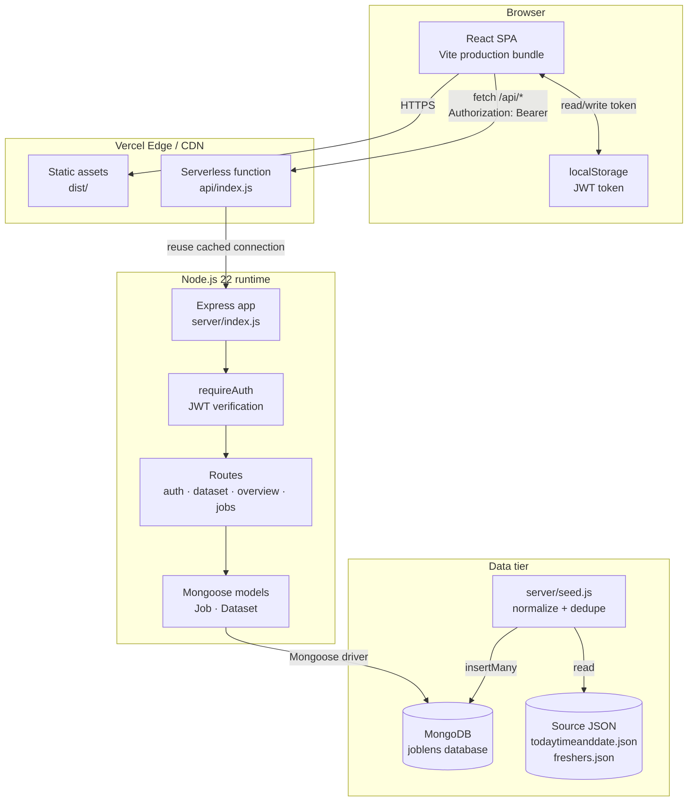
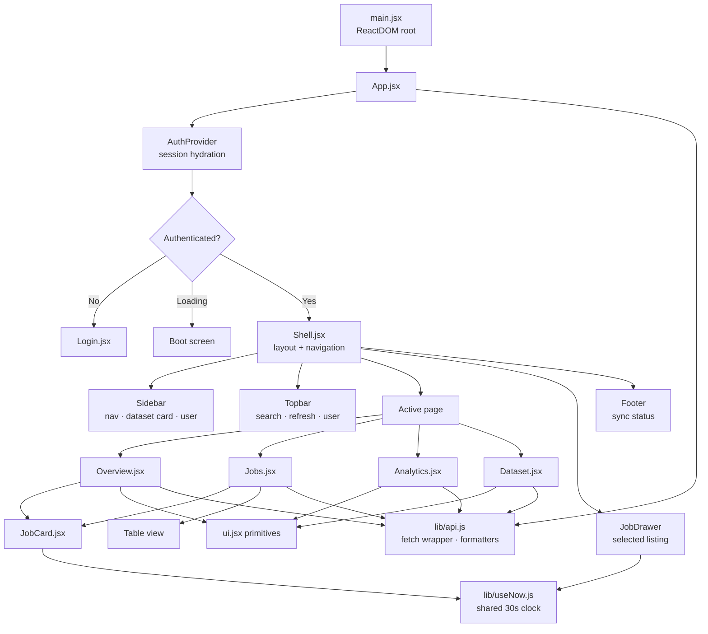
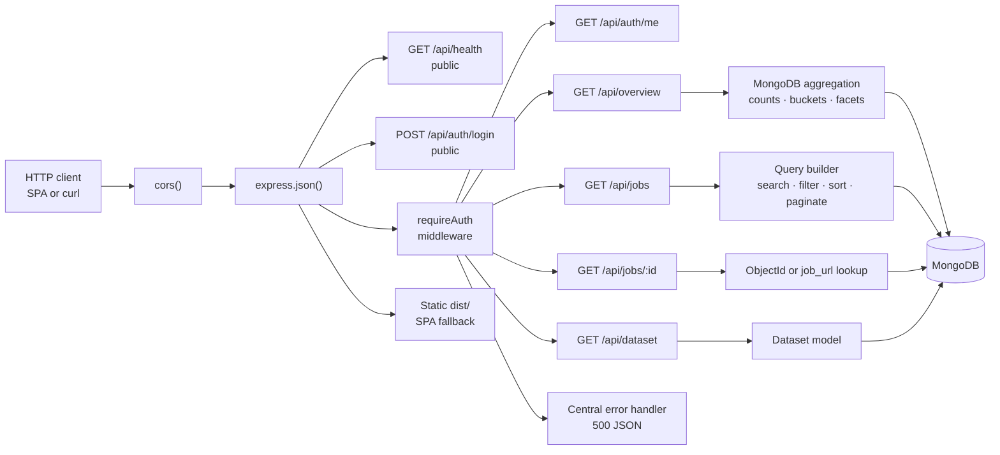
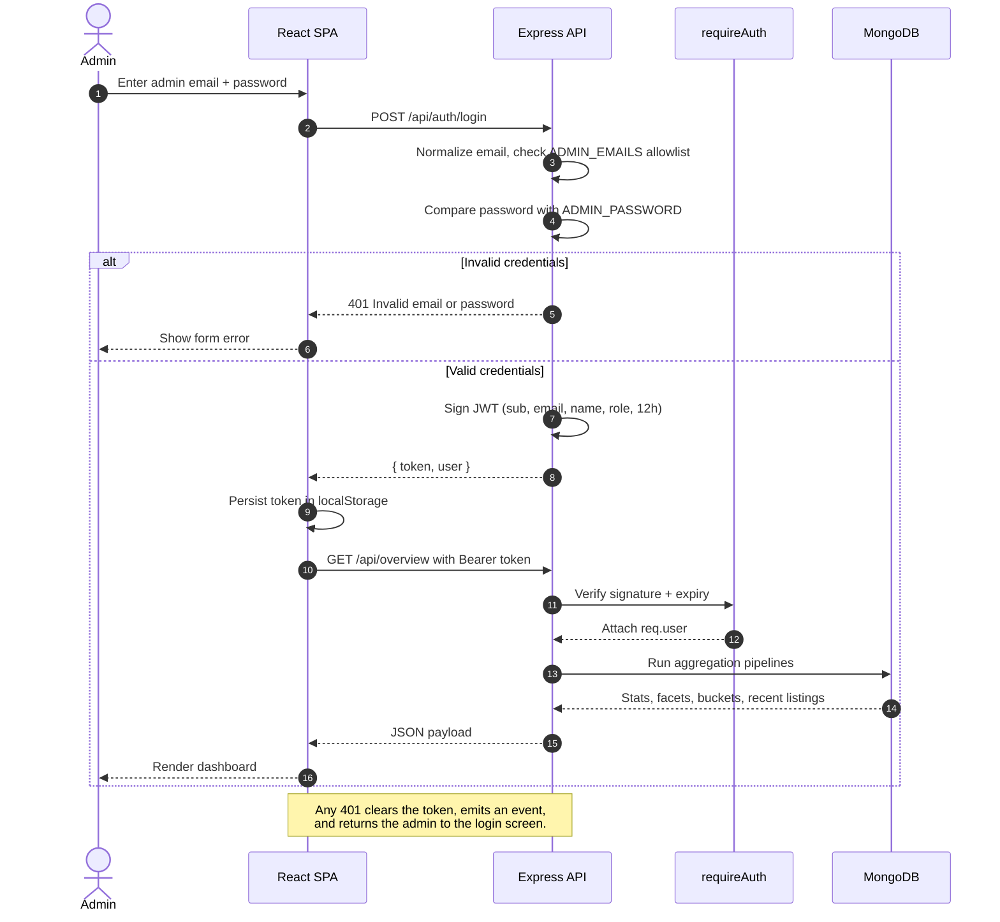
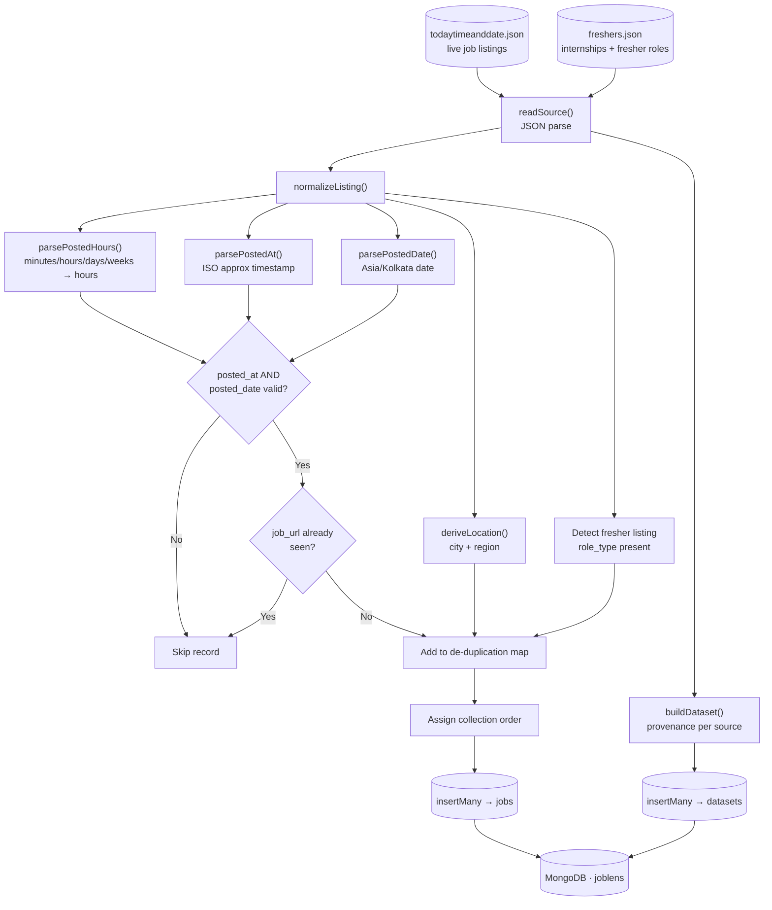
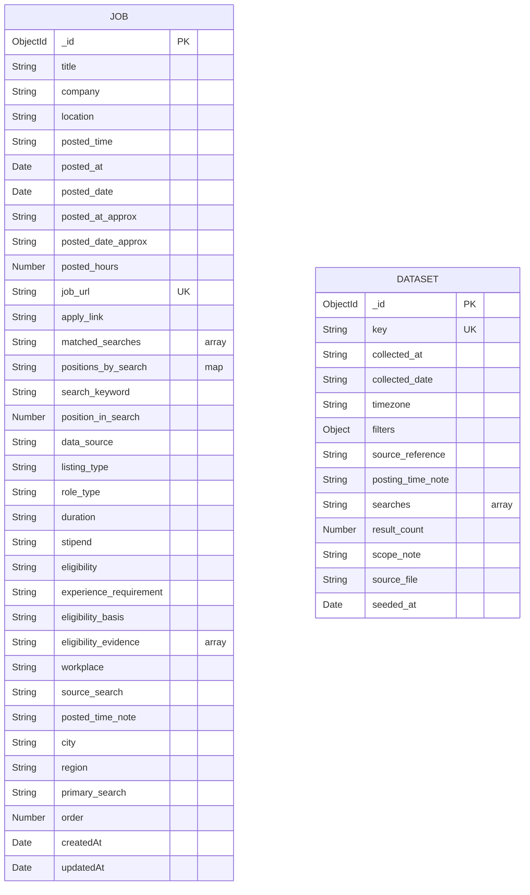
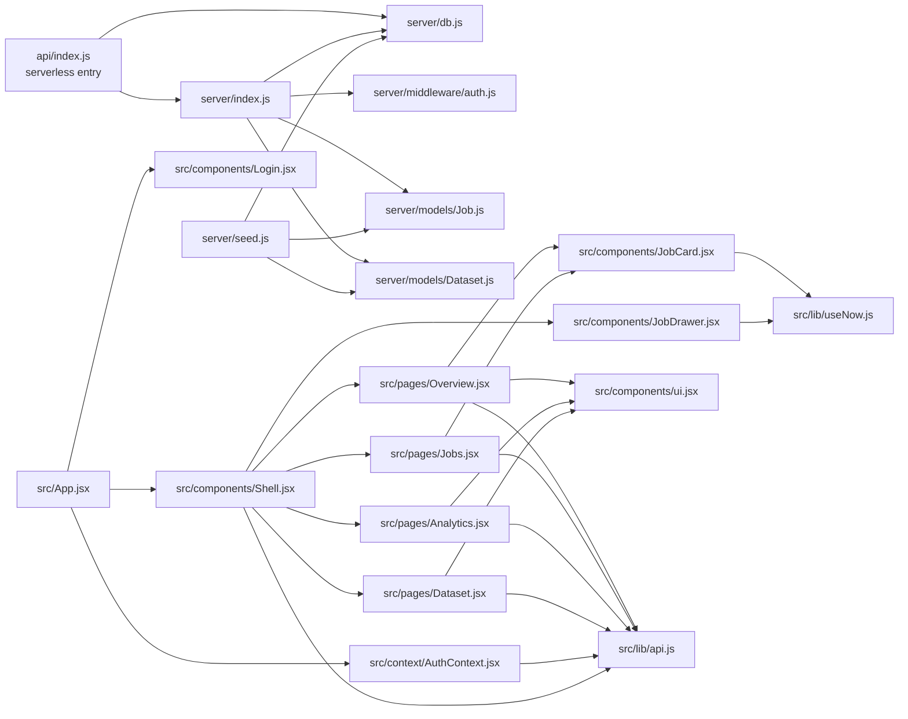

<p align="center">
  
</p>

<p align="center">
  <a href="https://github.com/sai4u-dev/linkedin-jobs"></a>
  
  
  
  
  
  
</p>

<h3 align="center">A private admin console for exploring, filtering and understanding a collected LinkedIn fresher job dataset.</h3>

<p align="center">
  JobLens ingests raw LinkedIn job-search JSON into MongoDB, exposes it through a JWT-protected Express API,
  and renders it in a responsive React dashboard with market overview, listing browser, analytics and dataset provenance.
</p>

---

## Table of Contents

- [Overview](#overview)
- [Feature Highlights](#feature-highlights)
- [Screenshots](#screenshots)
- [Tech Stack](#tech-stack)
- [Architecture](#architecture)
  - [High-Level System Architecture](#high-level-system-architecture)
  - [Frontend Architecture](#frontend-architecture)
  - [Backend Architecture](#backend-architecture)
  - [Authentication and Request Flow](#authentication-and-request-flow)
  - [Data Ingestion Pipeline](#data-ingestion-pipeline)
  - [Data Model](#data-model)
  - [Module Dependency Map](#module-dependency-map)
- [Project Structure](#project-structure)
- [Data Sources](#data-sources)
- [Getting Started](#getting-started)
  - [Prerequisites](#prerequisites)
  - [Installation](#installation)
  - [Environment Variables](#environment-variables)
  - [Seed the Database](#seed-the-database)
  - [Run in Development](#run-in-development)
  - [Production Build](#production-build)
- [Available Scripts](#available-scripts)
- [API Reference](#api-reference)
  - [Authentication](#authentication)
  - [Data Endpoints](#data-endpoints)
  - [Job Query Parameters](#job-query-parameters)
  - [Example Requests](#example-requests)
- [Deployment](#deployment)
  - [Deploy to Vercel (Recommended)](#deploy-to-vercel-recommended)
  - [Prepare MongoDB Atlas](#prepare-mongodb-atlas)
  - [Deploy with Docker](#deploy-with-docker)
  - [Deploy to a Node Host](#deploy-to-a-node-host)
  - [Post-Deployment Checklist](#post-deployment-checklist)
- [Security Notes](#security-notes)
- [Design and Performance Notes](#design-and-performance-notes)
- [Limitations and Roadmap](#limitations-and-roadmap)
- [Contributing](#contributing)
- [License](#license)

---

## Overview

JobLens is a **read-only intelligence console** built on top of job listings collected from public LinkedIn search result pages. It answers questions such as:

- How many fresher-friendly roles are currently live, and which companies are hiring?
- Which role tracks have the most listings, and how fresh are they?
- Which cities concentrate the most opportunity?
- How complete was the collection run — did every search return results?

The application has three moving parts:

1. **A JSON ingestion pipeline** (`server/seed.js`) that normalizes, de-duplicates and loads collected listings into MongoDB.
2. **An Express REST API** (`server/index.js`) that authenticates admins and serves aggregated, paginated data.
3. **A React SPA** (`src/`) that renders the admin experience in a dark, responsive interface.

The Express app is exported as a request handler, which means the **same codebase runs as a long-lived server locally and as a serverless function on Vercel**.

## Feature Highlights

| Area | Capabilities |
| --- | --- |
| **Authentication** | Admin email allowlist, shared password, signed JWT sessions (12-hour expiry), protected API routes, automatic session invalidation on `401` |
| **Overview** | Live listing count, hiring company count, average posting freshness, dual-track roles, search-coverage ring, role-track bars, freshness columns, top locations, primary-search donut, recent listings |
| **Job browser** | Debounced full-text search (title/company/location), role-track chips, location filter, five sort modes, card and table views, pagination, empty/error states |
| **Job details** | Slide-over drawer with company avatar, location, posted time, matched search tracks, ranking position per search track, apply and original LinkedIn links |
| **Analytics** | Top hiring track, strongest location, top primary search, share of roles posted in the last 3 hours, track distribution, search mix, location concentration, freshness curve, per-search coverage log |
| **Dataset provenance** | Collection time, seed time, source file, record counts, collection filters, timezone, source reference, search status log, scope notes |
| **Resilience** | Request-cancellation guards, skeleton loaders, retryable error cards, shared 30-second clock for relative timestamps |
| **Deployment** | Vercel-ready rewrite config, serverless-safe DB connection reuse, multi-stage Dockerfile for container hosts |

## Screenshots

> Captured from the running application with the seeded dataset.

<table>
  <tr>
    <td width="50%" align="center"><strong>Admin sign in</strong><br/><br/></td>
    <td width="50%" align="center"><strong>Market overview</strong><br/><br/></td>
  </tr>
  <tr>
    <td align="center"><strong>Job listings — card view</strong><br/><br/></td>
    <td align="center"><strong>Job detail drawer</strong><br/><br/></td>
  </tr>
  <tr>
    <td align="center"><strong>Job listings — table view</strong><br/><br/></td>
    <td align="center"><strong>Analytics</strong><br/><br/></td>
  </tr>
  <tr>
    <td align="center"><strong>Dataset &amp; coverage</strong><br/><br/></td>
    <td align="center"><strong>Brand mark</strong><br/><br/></td>
  </tr>
</table>

<details>
<summary><strong>Full-page captures</strong></summary>

<br />

| Overview | Analytics | Dataset |
| --- | --- | --- |
|  |  |  |

</details>

## Tech Stack

| Layer | Technology | Notes |
| --- | --- | --- |
| **UI** | React 18 | Function components, hooks, context, `useSyncExternalStore` |
| **Build** | Vite 6 | Dev server on port `5173`, `/api` proxy, production build in `dist/` |
| **Styling** | Hand-written CSS | Single global stylesheet, CSS custom properties, no UI framework |
| **API** | Node.js 22 + Express 4 | REST, JSON, CORS, static SPA fallback |
| **Database** | MongoDB + Mongoose 8 | `jobs` and `datasets` collections, aggregation pipelines, indexes |
| **Auth** | `jsonwebtoken` | HS256 bearer tokens, 12-hour expiry, allowlist + shared password |
| **Config** | `dotenv` | `.env` locally, platform environment variables in production |
| **Dev tooling** | `concurrently` | Runs API and Vite together |
| **Deployment** | Vercel or Docker | Serverless handler at `api/index.js`; multi-stage image included |

---

## Architecture

### High-Level System Architecture



The frontend never talks to MongoDB directly. Every read passes through the API, and every data endpoint (except `/api/health` and the login route) requires a valid bearer token. On Vercel, the static SPA is served from the CDN while `/api/*` is rewritten to a single serverless function that reuses a cached Mongoose connection across warm invocations.

### Frontend Architecture



`AuthProvider` owns the session lifecycle. On boot it reads the token from `localStorage` and calls `/api/auth/me`; if the call fails, the user is returned to the login screen. `Shell` is the single source of truth for the active page, refresh key, global search seed, selected job and the dataset summary shown in the sidebar. Pages are rendered conditionally rather than through a router, keeping the bundle small and navigation instant.

The `api()` helper centralises three behaviours:

1. Attaches `Content-Type: application/json` when a body exists.
2. Attaches `Authorization: Bearer <token>` when a token is stored.
3. Clears the token and emits `joblens:unauthorized` on any `401`, which `AuthProvider` listens for.

`useNow()` uses `useSyncExternalStore` to share a **single 30-second interval** across every card and drawer that renders relative timestamps, instead of starting one timer per component.

### Backend Architecture



Key backend decisions:

- **Dual runtime**: `server/index.js` exports `app`; it only calls `listen()` when executed directly (`isDirectRun`). `api/index.js` imports the same app and wraps it with a lazy, cached `connectDb()` promise for serverless reuse.
- **Defence in depth**: the login route validates the email against an allowlist before issuing a token; `requireAuth` verifies signature and expiry on every protected request.
- **Aggregation at the database**: counts, facet buckets and freshness distributions are computed in MongoDB rather than in Node or the browser.
- **Static hosting fallback**: if `dist/` exists, Express serves the built SPA and sends `index.html` for any non-API route.

### Authentication and Request Flow



The JWT payload has the shape:

```json
{
  "sub": "admin@example.com",
  "email": "admin@example.com",
  "name": "Admin",
  "role": "admin",
  "iat": 1763000000,
  "exp": 1763043200
}
```

### Data Ingestion Pipeline



The seeder is intentionally destructive: it deletes the existing `jobs` and `datasets` documents before inserting a fresh snapshot. It reads only `todaytimeanddate.json` and `freshers.json`; the other JSON files in the repository are raw collection artifacts kept for reference.

Normalization rules:

- `posted_time` strings such as `"10 minutes ago"`, `"3 hours ago"` or `"2 days ago"` are converted into decimal `posted_hours`.
- `posted_at` comes from `posted_at_approx`; `posted_date` is parsed at midnight in `Asia/Kolkata`.
- `location` is split on commas into `city` and `region`.
- Listings are de-duplicated by `job_url`; the first occurrence wins.
- Fresher records get `listing_type: "fresher"` and a fallback search track of `Fresher openings`.
- `primary_search` is the first matched search, then `search_keyword`, then `Fresher openings`, then `Unclassified`.

### Data Model



There is no hard foreign key between `Job` and `Dataset`; the relationship is logical, through the source file and collection run recorded in the dataset provenance document. Each `Dataset.searches[]` entry captures the keyword, source URL, visible card count, collection flag and collection timestamp.

#### `jobs` indexes

| Index | Purpose |
| --- | --- |
| `title`, `company`, `location` (text) | Full-text search |
| `order` | Default collection-order sorting |
| `posted_hours` | Freshness sorting and buckets |
| `posted_at`, `posted_date` | Recency queries |
| `matched_searches` | Role-track filtering and facet aggregation |
| `search_keyword` | Primary-search analytics |
| `data_source` | Source breakdowns |
| `listing_type` | Job vs. fresher filtering |
| `job_url` (unique) | De-duplication |

### Module Dependency Map



---

## Project Structure

```text
linkedin-jobs/
├── api/
│   └── index.js                  Vercel serverless entry — cached DB connection + Express app
├── docs/
│   ├── banner.svg                Repository banner
│   └── screenshots/              Captured UI screenshots (WebP)
├── public/
│   └── favicon.svg               Browser icon / brand mark
├── server/
│   ├── index.js                  Express app: auth, dataset, overview, jobs, static SPA
│   ├── db.js                     Mongoose connection helper
│   ├── seed.js                   JSON → normalized → MongoDB ingestion
│   ├── middleware/
│   │   └── auth.js               Bearer token verification
│   └── models/
│       ├── Job.js                Listing schema, indexes and defaults
│       └── Dataset.js            Collection provenance schema
├── src/
│   ├── main.jsx                  React entry point
│   ├── App.jsx                   Auth gate (boot / login / shell)
│   ├── context/
│   │   └── AuthContext.jsx       Login, logout, session hydration
│   ├── lib/
│   │   ├── api.js                Fetch wrapper, token storage, formatters
│   │   └── useNow.js             Shared 30-second clock
│   ├── components/
│   │   ├── Shell.jsx             Sidebar, topbar, page routing, drawer state
│   │   ├── Login.jsx             Split-screen admin sign-in
│   │   ├── JobCard.jsx           Listing card
│   │   ├── JobDrawer.jsx         Listing detail drawer
│   │   ├── Icon.jsx              Inline SVG icon set
│   │   └── ui.jsx                Stat cards, charts, skeletons, empty/error states
│   ├── pages/
│   │   ├── Overview.jsx          Market snapshot and recent listings
│   │   ├── Jobs.jsx              Searchable, filterable, paginated browser
│   │   ├── Analytics.jsx         Distribution, location and coverage analytics
│   │   └── Dataset.jsx           Provenance, filters and search status log
│   └── styles.css                Global dark theme and responsive layout
├── index.html                    Vite HTML shell
├── vite.config.js                React plugin, dev proxy, build output
├── vercel.json                   Build/output config and /api rewrite
├── Dockerfile                    Multi-stage production image
├── .dockerignore
├── .env.example                  Environment template
├── package.json                  Scripts, dependencies, Node 22 engine
├── LICENSE                       MIT
└── README.md
```

## Data Sources

| File | Imported by seed | Purpose |
| --- | --- | --- |
| `todaytimeanddate.json` | Yes | Primary live listing snapshot; drives the `default` dataset and most of the overview |
| `freshers.json` | Yes | Fresher/internship listings with role type, duration, stipend and eligibility evidence; drives the `freshers` dataset |
| `new_job_listings.json` | No | Earlier raw collection artifact kept for reference |
| `new_job_listings copy.json` | No | Duplicate copy of the above |
| `lob_listing.json` | No | Older raw collection artifact |
| `dateandtime.json` | No | Older raw collection artifact |

Each imported listing is expected to include at minimum:

```json
{
  "title": "FULL STACK WEB DEVELOPER",
  "company": "Talent to Job",
  "location": "India",
  "posted_time": "10 minutes ago",
  "job_url": "https://in.linkedin.com/jobs/view/...",
  "matched_searches": ["Node Js Developer"],
  "positions_by_search": { "Node Js Developer": 51 }
}
```

---

## Getting Started

### Prerequisites

- **Node.js 22.x** — enforced by `"engines": { "node": "22.x" }`
- **npm** (ships with Node)
- **MongoDB** — a local instance or a MongoDB Atlas cluster
- Git

Verify your toolchain:

```bash
node --version   # v22.x
npm --version
```

### Installation

```bash
git clone https://github.com/sai4u-dev/linkedin-jobs.git
cd linkedin-jobs
npm install
```

### Environment Variables

Copy the template and edit it:

```bash
cp .env.example .env
```

| Variable | Required | Default | Description |
| --- | --- | --- | --- |
| `PORT` | No | `4000` | Port for the standalone Express server |
| `MONGODB_URI` | No | `mongodb://127.0.0.1:27017/joblens` | MongoDB connection string |
| `JWT_SECRET` | **Yes in production** | `dev-secret` | Secret used to sign and verify session tokens |
| `ADMIN_EMAILS` | No | Built-in allowlist | Comma-separated list of admin emails |
| `ADMIN_PASSWORD` | **Yes in production** | Development fallback (see `.env.example`) | Shared password for all allowlisted admins |

> **Never commit `.env`.** It is already listed in `.gitignore`. Use long, random values for `JWT_SECRET` and `ADMIN_PASSWORD` in any shared or public deployment.

Example `.env`:

```dotenv
PORT=4000
MONGODB_URI=mongodb://127.0.0.1:27017/joblens
JWT_SECRET=replace-with-a-long-random-string
ADMIN_EMAILS=admin@example.com,recruiter@example.com
ADMIN_PASSWORD=replace-with-a-strong-password
```

### Seed the Database

```bash
npm run seed
```

Expected output:

```text
Connected to MongoDB
Seeded 365 listings across 2 sources into MongoDB
Skipped 1 invalid/duplicate rows
Database: joblens
```

The script **replaces** the contents of the `jobs` and `datasets` collections. Re-run it whenever the source JSON files change.

### Run in Development

```bash
npm run dev
```

| Service | URL | Notes |
| --- | --- | --- |
| Frontend | <http://localhost:5173> | Vite dev server with hot module replacement |
| API | <http://localhost:4000> | Node watch mode; Vite proxies `/api` to this port |
| Health | <http://localhost:4000/api/health> | Confirms the API and MongoDB connection |

Sign in with any email in `ADMIN_EMAILS` and the configured `ADMIN_PASSWORD`.

### Production Build

```bash
npm run build
npm start
```

`npm run build` emits the SPA into `dist/`. When `dist/` exists, `server/index.js` serves it and falls back to `index.html` for client-side routes, so a single Node process can host both the UI and the API.

---

## Available Scripts

| Script | Command | Description |
| --- | --- | --- |
| `npm run dev` | `concurrently ...` | Runs API and Vite concurrently with colour-coded logs |
| `npm run dev:web` | `vite` | Frontend dev server only |
| `npm run dev:server` | `node --watch server/index.js` | API server with file watching |
| `npm run build` | `vite build` | Production frontend build into `dist/` |
| `npm run preview` | `vite preview` | Preview the production build locally |
| `npm start` | `node server/index.js` | Start Express (serves `dist/` when present) |
| `npm run seed` | `node server/seed.js` | Replace MongoDB data from the JSON sources |

There is currently no dedicated lint or test script. Run `npm run build` before opening a pull request.

---

## API Reference

Base URL locally: `http://localhost:4000/api`. In production: `https://<your-domain>/api`.

All protected routes require:

```http
Authorization: Bearer <jwt>
```

### Authentication

#### `POST /api/auth/login`

Validates the email against `ADMIN_EMAILS` and the password against `ADMIN_PASSWORD`.

```json
{
  "email": "admin@example.com",
  "password": "your-password"
}
```

**200 response**

```json
{
  "token": "eyJhbGciOiJIUzI1NiIsInR5cCI6IkpXVCJ9...",
  "user": {
    "email": "admin@example.com",
    "username": "admin@example.com",
    "name": "Admin",
    "role": "admin"
  }
}
```

**401 response**

```json
{ "error": "Invalid email or password" }
```

#### `GET /api/auth/me`

Returns the user encoded in the current token. Used on boot to hydrate the session.

```json
{
  "user": {
    "email": "admin@example.com",
    "username": "admin@example.com",
    "name": "Admin",
    "role": "admin"
  }
}
```

### Data Endpoints

#### `GET /api/health`

Public. Reports API liveness and MongoDB connection state.

```json
{ "ok": true, "db": "connected" }
```

#### `GET /api/dataset`

Returns the `default` dataset provenance document plus a live listing total.

```json
{
  "key": "default",
  "collected_at": "2026-11-13T10:55:00+05:30",
  "collected_date": "2026-11-13",
  "timezone": "Asia/Kolkata",
  "filters": { "location": "India", "posted_within": "Past 24 hours" },
  "source_reference": "new_job_listings.json",
  "posting_time_note": "...",
  "searches": [
    {
      "keyword": "Software Engineer",
      "source_url": "https://www.linkedin.com/jobs/search/...",
      "visible_card_count": 60,
      "results_collected": true,
      "collected_at": "2026-11-13T10:54:00+05:30"
    }
  ],
  "result_count": 326,
  "scope_note": "...",
  "source_file": "todaytimeanddate.json",
  "seeded_at": "2026-11-13T22:31:00.000Z",
  "total_listings": 365
}
```

#### `GET /api/overview`

Returns every aggregate used by the Overview and Analytics pages in a single request.

Key response fields:

| Field | Description |
| --- | --- |
| `stats.total` | Total listings |
| `stats.companies` | Distinct companies |
| `stats.filters` | Number of role tracks |
| `stats.locations` | Distinct cities in the top-location aggregation |
| `stats.multiFilter` | Listings matched by 2+ search tracks |
| `stats.avgHours` | Mean `posted_hours` |
| `stats.latestPostedHours` | Freshest listing age in hours |
| `filterCounts` | Listings per matched search track |
| `locationCounts` | Top 8 cities by listing count |
| `primarySearchCounts` | Listings per primary search |
| `postedBuckets` | Freshness buckets (`0–1h`, `1–3h`, `3–6h`, `6–12h`, `12–24h`, `24h+`) |
| `recent` | Six freshest listings |
| `dataset` | Dataset provenance document |
| `searchSummary` | Total/collected/unavailable search counts |

```json
{
  "stats": {
    "total": 365,
    "companies": 240,
    "filters": 10,
    "locations": 8,
    "multiFilter": 192,
    "avgHours": 14.5,
    "latestPostedHours": 0.1
  },
  "filterCounts": [
    { "name": "JavaScript", "count": 80 },
    { "name": "Full Stack Developer", "count": 61 }
  ],
  "postedBuckets": [
    { "label": "0–1h", "count": 9 },
    { "label": "1–3h", "count": 19 }
  ],
  "searchSummary": { "total": 10, "collected": 10, "unavailable": 0 }
}
```

#### `GET /api/jobs`

Paginated, searchable listing browser. Returns the current page plus **global** facets for filters and locations.

```json
{
  "items": [
    {
      "_id": "6731f...",
      "title": "Full Stack Web Developer",
      "company": "Talent to Job",
      "location": "India",
      "posted_hours": 0.17,
      "posted_at": "2026-11-13T05:25:00.000Z",
      "posted_date_approx": "2026-11-13",
      "job_url": "https://in.linkedin.com/jobs/view/...",
      "matched_searches": ["Node Js Developer"],
      "data_source": "live",
      "city": "India",
      "region": "India",
      "order": 1
    }
  ],
  "total": 365,
  "page": 1,
  "pages": 41,
  "limit": 9,
  "facets": {
    "filters": [{ "name": "JavaScript", "count": 80 }],
    "locations": [{ "name": "Bengaluru", "count": 83 }]
  }
}
```

#### `GET /api/jobs/:id`

Looks up a listing by MongoDB `_id` when the value is a valid ObjectId, otherwise by exact `job_url`.

```bash
curl "http://localhost:4000/api/jobs/6731f0f0c0a1b2c3d4e5f678" \
  -H "Authorization: Bearer $TOKEN"

curl "http://localhost:4000/api/jobs/https%3A%2F%2Fin.linkedin.com%2Fjobs%2Fview%2F..." \
  -H "Authorization: Bearer $TOKEN"
```

**404 response**

```json
{ "error": "Job not found" }
```

### Job Query Parameters

| Parameter | Type | Default | Allowed values / behaviour |
| --- | --- | --- | --- |
| `q` | string | `""` | Case-insensitive regex across `title`, `company`, `location`; regex metacharacters are escaped |
| `filter` | string | `""` | Must exactly match an entry in `matched_searches` |
| `location` | string | `""` | Case-insensitive regex across `city`, `region`, `location`, `search_keyword` |
| `sort` | enum | `order` | `order`, `recent`, `oldest`, `company`, `title` |
| `page` | integer | `1` | Minimum `1` |
| `limit` | integer | `9` | Clamped between `1` and `50` |

Sort mappings:

| Value | MongoDB sort |
| --- | --- |
| `order` | `{ order: 1 }` |
| `recent` | `{ posted_hours: 1, order: 1 }` |
| `oldest` | `{ posted_hours: -1, order: 1 }` |
| `company` | `{ company: 1, order: 1 }` |
| `title` | `{ title: 1, order: 1 }` |

### Example Requests

```bash
# 1. Log in and capture the token
TOKEN=$(curl -s -X POST http://localhost:4000/api/auth/login \
  -H "Content-Type: application/json" \
  -d '{"email":"admin@example.com","password":"your-password"}' \
  | node -pe "JSON.parse(require('fs').readFileSync(0,'utf8')).token")

# 2. Health check (public)
curl http://localhost:4000/api/health

# 3. Overview aggregates
curl http://localhost:4000/api/overview -H "Authorization: Bearer $TOKEN"

# 4. Search React roles in Bengaluru, newest first
curl "http://localhost:4000/api/jobs?q=react&location=Bengaluru&sort=recent&page=1&limit=12" \
  -H "Authorization: Bearer $TOKEN"

# 5. Filter by role track
curl "http://localhost:4000/api/jobs?filter=Node%20Js%20Developer" \
  -H "Authorization: Bearer $TOKEN"

# 6. Dataset provenance
curl http://localhost:4000/api/dataset -H "Authorization: Bearer $TOKEN"
```

Error responses:

| Status | Body | Cause |
| --- | --- | --- |
| `401` | `{ "error": "Authentication required" }` | Missing bearer token |
| `401` | `{ "error": "Session expired. Please sign in again." }` | Invalid/expired token |
| `404` | `{ "error": "Job not found" }` | Unknown `_id` or `job_url` |
| `500` | `{ "error": "Something went wrong on the server" }` | Unhandled server error |

---

## Deployment

The project supports three deployment styles:

1. **Vercel** — static SPA on the CDN plus a serverless API function (`api/index.js`). Recommended because the repository is already configured.
2. **Docker / VPS** — one container running Express, which serves both the built SPA and the API.
3. **Node host** — Render, Railway, Fly.io, Heroku-style platforms that run `npm start`.

In every case, MongoDB should be a managed instance such as **MongoDB Atlas**, not a database inside the app container.

### Deploy to Vercel (Recommended)

#### 1. Prepare MongoDB Atlas

1. Create a free or paid Atlas cluster.
2. Create a database user with read/write access to the `joblens` database.
3. Under **Network Access**, allow your deployment to connect:
   - For Vercel, the simplest option is `0.0.0.0/0` with a strong database password, because Vercel does not provide fixed egress IPs on every plan.
   - For stricter setups, use a NAT gateway with static IPs and allowlist those IPs.
4. Copy the connection string, for example:

   ```text
   mongodb+srv://joblens:<password>@cluster0.xxxxx.mongodb.net/joblens?retryWrites=true&w=majority
   ```

#### 2. Import the repository

1. Push the repository to GitHub.
2. In Vercel, choose **Add New → Project** and import `sai4u-dev/linkedin-jobs`.
3. Vercel detects Vite automatically; `vercel.json` supplies the authoritative configuration:

   ```json
   {
     "framework": "vite",
     "buildCommand": "npm run build",
     "outputDirectory": "dist",
     "rewrites": [{ "source": "/api/(.*)", "destination": "/api/index" }]
   }
   ```

   - Frontend build: `npm run build` → `dist/`
   - API: every `/api/*` request is rewritten to the serverless function at `api/index.js`
   - The function imports the same Express app used locally and lazily creates a cached Mongoose connection.

#### 3. Configure environment variables

In **Project Settings → Environment Variables**, add:

| Name | Example | Environments |
| --- | --- | --- |
| `MONGODB_URI` | `mongodb+srv://joblens:.../joblens` | Production, Preview, Development |
| `JWT_SECRET` | A long random string | Production, Preview |
| `ADMIN_EMAILS` | `admin@example.com,ops@example.com` | Production, Preview |
| `ADMIN_PASSWORD` | A strong shared password | Production, Preview |

`PORT` is not needed on Vercel; the platform provides the port and handler.

#### 4. Deploy

Click **Deploy**. After the build completes:

```text
https://<project>.vercel.app          → SPA
https://<project>.vercel.app/api/health → { "ok": true, "db": "connected" }
```

#### 5. Seed the production database

The seed script is a CLI task, so run it once from your machine against the production database:

```bash
MONGODB_URI="mongodb+srv://joblens:<password>@cluster0.xxxxx.mongodb.net/joblens" npm run seed
```

On Windows PowerShell:

```powershell
$env:MONGODB_URI="mongodb+srv://joblens:<password>@cluster0.xxxxx.mongodb.net/joblens"; npm run seed
```

> The seeder **deletes** existing `jobs` and `datasets` documents before inserting. Re-run it whenever the JSON sources change, ideally as a controlled release step.

#### 6. Custom domain and previews

- Add a custom domain under **Project Settings → Domains**; Vercel provisions TLS automatically.
- Preview deployments use the same environment variables unless you scope them differently. Consider pointing previews at a staging database.

### Prepare MongoDB Atlas

For any deployment target:

1. Create the cluster and database user.
2. Whitelist the deployment network.
3. Use a database named `joblens`.
4. Keep the connection string secret; never place it in `vercel.json`, the Dockerfile or the repository.
5. Enable backups appropriate for your plan.
6. Optionally create a read-only Atlas user for analytics tooling.

### Deploy with Docker

The included `Dockerfile` builds the SPA in a first stage and ships a slim production runtime in a second stage.

```bash
# Build the image
docker build -t joblens-admin .

# Run against an external MongoDB
docker run --rm -p 4000:4000 \
  -e MONGODB_URI="mongodb+srv://joblens:<password>@cluster0.xxxxx.mongodb.net/joblens" \
  -e JWT_SECRET="replace-with-a-long-random-string" \
  -e ADMIN_EMAILS="admin@example.com" \
  -e ADMIN_PASSWORD="replace-with-a-strong-password" \
  joblens-admin
```

Or use an env file (never commit it):

```bash
docker run --rm -p 4000:4000 --env-file .env joblens-admin
```

Open <http://localhost:4000>. The runtime image:

- Uses `node:22-alpine`
- Installs production dependencies only (`npm ci --omit=dev`)
- Copies the built `dist/` and the `server/` folder
- Exposes port `4000`
- Includes a `HEALTHCHECK` against `/api/health`

If MongoDB runs on the Docker host, use `host.docker.internal` instead of `127.0.0.1` in `MONGODB_URI` (Docker Desktop). On Linux, use the host bridge address or a user-defined network.

Behind a reverse proxy, terminate TLS with Nginx, Caddy or Traefik and forward to port `4000`. Example Caddyfile:

```caddyfile
joblens.example.com {
  reverse_proxy 127.0.0.1:4000
}
```

### Deploy to a Node Host

For platforms that run a Node process (Render, Railway, Fly.io, a VPS, etc.):

```bash
npm ci
npm run build
npm start
```

Configure:

- **Build command:** `npm ci && npm run build`
- **Start command:** `npm start`
- **Node version:** 22.x
- **Environment:** `MONGODB_URI`, `JWT_SECRET`, `ADMIN_EMAILS`, `ADMIN_PASSWORD`
- **Health check path:** `/api/health`

Express serves `dist/` automatically, so no separate static host is required. Run the seeder once against the production database with the same `MONGODB_URI`.

### Post-Deployment Checklist

- [ ] `/api/health` returns `{ "ok": true, "db": "connected" }`
- [ ] The login page loads over HTTPS
- [ ] An allowlisted admin can sign in and reach the dashboard
- [ ] The overview shows non-zero listings (database has been seeded)
- [ ] Job search, filters, sorting and pagination work
- [ ] The job drawer opens and apply links point to LinkedIn
- [ ] `JWT_SECRET` and `ADMIN_PASSWORD` are long, random and unique
- [ ] `.env` is not committed and no secrets are present in the client bundle
- [ ] Atlas network access and database users follow least privilege
- [ ] Database backups are enabled
- [ ] The deployment has a plan for refreshing the dataset

---

## Security Notes

The current implementation is intentionally lightweight and suitable for a **private internal console**. Before exposing it broadly, review the following:

| Area | Current behaviour | Recommended hardening |
| --- | --- | --- |
| **Credentials** | One shared password for all allowlisted emails | Move to per-user accounts with hashed passwords (bcrypt/argon2) or an identity provider |
| **Token storage** | JWT in `localStorage` | Prefer `httpOnly`, `Secure`, `SameSite` cookies to reduce XSS token theft |
| **CORS** | `cors()` with default (allow all) | Restrict to known frontend origins |
| **Rate limiting** | None | Add rate limiting on `/api/auth/login` and the API generally |
| **Headers** | Default Express headers | Add `helmet` and a Content Security Policy |
| **Transport** | Plain HTTP locally | Always terminate TLS in production |
| **Secrets** | `.env` (git-ignored) | Use the platform secret manager; rotate `JWT_SECRET` and `ADMIN_PASSWORD` |
| **Database** | Connection string grants read/write | Use least-privilege users, network allowlists and backups |
| **Audit** | No login or access logs | Add structured logging and login auditing if required |

Additional notes:

- Sessions expire after **12 hours**; there is no refresh token.
- Any `401` clears the local token and dispatches `joblens:unauthorized`.
- Default values in `server/index.js` and `.env.example` are development conveniences and **must be replaced** in production.
- The API is read-only: there are no create, update or delete endpoints for job data.

## Design and Performance Notes

- **Server-side aggregation** — counts, facets and freshness buckets are computed with MongoDB aggregation pipelines, avoiding large payloads.
- **Pagination** — the jobs endpoint is capped at 50 items per page; the UI uses 9.
- **Debounced search** — the listing search waits 300 ms after typing before issuing a request.
- **Cancellation guards** — every page ignores stale responses using a `cancelled` flag, preventing out-of-order state updates.
- **Shared clock** — `useNow()` uses `useSyncExternalStore` so all relative timestamps share one 30-second timer.
- **Singleton DB connection** — `api/index.js` caches the connection promise for serverless warm starts, with automatic reset on failure.
- **Indexed queries** — text, freshness, role-track and source indexes back the common access patterns.
- **Graceful states** — skeleton loaders, empty states and retryable error cards are used throughout.
- **Zero UI dependencies** — icons and charts are hand-built SVG/CSS, keeping the client bundle small.

## Limitations and Roadmap

Current limitations:

- Read-only console; listings cannot be edited from the UI.
- No automated scraping — source JSON is collected externally and imported with `npm run seed`.
- Single shared admin password rather than individual accounts.
- No automated test suite, CI workflow or lint configuration.
- No rate limiting, audit log or role-based permissions.
- No scheduled ingestion; refreshing data is a manual seed step.

Potential next steps:

- Add per-user authentication with hashed passwords or SSO.
- Add a scheduled ingestion job and dataset versioning.
- Add saved searches, CSV export and shareable filter URLs.
- Add API pagination metadata and caching headers.
- Add automated tests for normalization, aggregation and auth.
- Add Docker Compose with a local MongoDB for one-command onboarding.
- Add observability (structured logs, metrics, uptime checks).

## Contributing

1. Fork the repository and create a feature branch.
2. Install dependencies with `npm install`.
3. Make your change and keep the existing code style (no semicolons, single quotes, functional React components).
4. Run `npm run build` to confirm the frontend compiles.
5. Open a pull request describing the change and any verification performed.

Please do not commit `.env`, database dumps or credentials.

## License

Distributed under the **MIT License**. See [LICENSE](LICENSE) for the full text.

---

<p align="center">
  Built for exploring fresher hiring signals, one dataset at a time.
</p>
