<p align="center">
  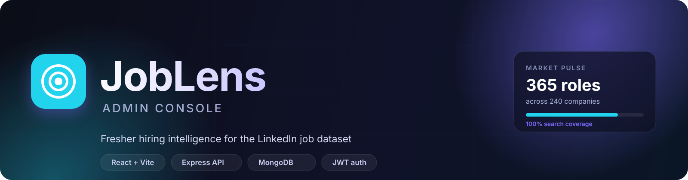
</p>

<p align="center">
  <a href="https://github.com/sai4u-dev/linkedin-jobs"></a>
  
  
  
  
  
  
</p>

<h3 align="center">A private admin console for exploring, filtering and understanding a collected LinkedIn fresher job dataset.</h3>

<p align="center">
  JobLens ingests raw LinkedIn job-search JSON into MongoDB, exposes it through a JWT-protected Express API,
  and renders it in a responsive React dashboard with market overview, listing browser, analytics and dataset provenance.
</p>

**How to read this README**

| If you are… | Start with | Then read |
| --- | --- | --- |
| A stakeholder, founder or product owner | [Product Presentation](#product-presentation) | [Screenshots](#screenshots), [Value Proposition](#value-proposition) |
| A recruiter or end user | [What Is JobLens?](#what-is-joblens) | [What You Can Do](#what-you-can-do), [Screenshots](#screenshots) |
| An engineer onboarding to the code | [Technical Documentation](#technical-documentation) | [Architecture](#high-level-system-architecture), [Project Structure](#project-structure) |
| An API consumer | [API Reference](#api-reference) | [Authentication](#authentication), [Example Requests](#example-requests) |
| An operator or DevOps engineer | [Deployment](#deployment) | [Observability and Operations](#observability-and-operations), [Security Notes](#security-notes) |

---

## Table of Contents

- [Product Presentation](#product-presentation)
  - [What Is JobLens?](#what-is-joblens)
  - [The Problem It Solves](#the-problem-it-solves)
  - [Who It Serves](#who-it-serves)
  - [What You Can Do](#what-you-can-do)
  - [Why JobLens](#why-joblens)
  - [Product Journey](#product-journey)
  - [How Teams Use It](#how-teams-use-it)
  - [Product Scope](#product-scope)
  - [Value Proposition](#value-proposition)
  - [Success Measures](#success-measures)
- [Feature Highlights](#feature-highlights)
- [Screenshots](#screenshots)
- [Tech Stack](#tech-stack)
- [Technical Documentation](#technical-documentation)
  - [Engineering Goals and Constraints](#engineering-goals-and-constraints)
  - [Technology Decisions](#technology-decisions)
  - [Code Organization and Conventions](#code-organization-and-conventions)
  - [High-Level System Architecture](#high-level-system-architecture)
  - [Frontend Architecture](#frontend-architecture)
  - [Frontend Engineering Details](#frontend-engineering-details)
  - [Backend Architecture](#backend-architecture)
  - [Backend Engineering Details](#backend-engineering-details)
  - [Authentication and Request Flow](#authentication-and-request-flow)
  - [Data Ingestion Pipeline](#data-ingestion-pipeline)
  - [Data Model](#data-model)
  - [Module Dependency Map](#module-dependency-map)
  - [API Design Conventions](#api-design-conventions)
  - [Error Handling and Failure Modes](#error-handling-and-failure-modes)
  - [Performance and Scalability](#performance-and-scalability)
  - [Security Engineering](#security-engineering)
  - [Testing and Quality](#testing-and-quality)
  - [Observability and Operations](#observability-and-operations)
  - [Extensibility and Extension Points](#extensibility-and-extension-points)
  - [Engineering Trade-offs and Technical Debt](#engineering-trade-offs-and-technical-debt)
  - [Build and Release Flow](#build-and-release-flow)
- [Project Structure](#project-structure)
- [Data Sources](#data-sources)
- [Getting Started](#getting-started)
  - [Prerequisites](#prerequisites)
  - [Installation](#installation)
  - [Environment Variables](#environment-variables)
  - [Seed the Database](#seed-the-database)
  - [Run in Development](#run-in-development)
  - [Production Build](#production-build)
- [Available Scripts](#available-scripts)
- [API Reference](#api-reference)
  - [Authentication](#authentication)
  - [Data Endpoints](#data-endpoints)
  - [Job Query Parameters](#job-query-parameters)
  - [Example Requests](#example-requests)
- [Deployment](#deployment)
  - [Deploy to Vercel (Recommended)](#deploy-to-vercel-recommended)
  - [Prepare MongoDB Atlas](#prepare-mongodb-atlas)
  - [Deploy with Docker](#deploy-with-docker)
  - [Deploy to a Node Host](#deploy-to-a-node-host)
  - [Post-Deployment Checklist](#post-deployment-checklist)
- [Security Notes](#security-notes)
- [Design and Performance Notes](#design-and-performance-notes)
- [Limitations and Roadmap](#limitations-and-roadmap)
- [Contributing](#contributing)
- [License](#license)

---

## Product Presentation

### What Is JobLens?

JobLens is a private, **read-only admin console** that turns a raw LinkedIn job-search export into a navigable intelligence layer for fresher hiring. It is not a job board and it does not scrape LinkedIn at runtime: it ingests pre-collected JSON snapshots, normalizes them into MongoDB, and serves a focused dashboard for understanding the roles, companies, locations and collection quality inside that snapshot.

> **One-line positioning:** JobLens turns a static LinkedIn job export into a searchable, explainable view of fresher hiring activity.

The product is built around a simple idea: **a dataset is only useful if you can see what is in it, how fresh it is, and whether you can trust it.** JobLens puts those three answers on one screen instead of leaving them buried in a JSON file or a spreadsheet.

### The Problem It Solves

| Problem | Why it matters | How JobLens addresses it |
| --- | --- | --- |
| **Raw exports are hard to read** | LinkedIn collections arrive as large JSON files with repeated fields, long URLs and nested search metadata | Normalizes every listing into a consistent schema with derived city, region, freshness and primary search |
| **LinkedIn optimizes for applying, not analysis** | There is no built-in way to compare role tracks, cities or companies across an entire collected snapshot | Adds an overview and analytics layer with counts, distributions, freshness buckets and coverage |
| **Spreadsheets drift** | Manual copies become stale, formulas break and provenance is lost | Stores one canonical snapshot in MongoDB and derives every number from it at request time |
| **Collection quality is invisible** | A dashboard can look convincing even when half the searches failed or returned duplicates | Surfaces per-search status, visible card counts, coverage percentages and collection notes |
| **Repeat questions are slow** | “Which tracks are hot?”, “Which cities?”, “How fresh?” require re-reading files each time | Pre-aggregated API responses make these answers a single click |
| **Listings lack action context** | A flat row does not show which search found a role, where it ranked, or where to apply | The job drawer shows matched tracks, per-track ranking, original link and apply link |

### Who It Serves

| Audience | Primary need | How JobLens helps |
| --- | --- | --- |
| **Talent acquisition / recruiting teams** | Understand the competitive fresher market and which companies are hiring | Market totals, role-track distribution, location concentration, searchable listings |
| **Hiring managers and founders** | Validate demand for a role, skill track or location before opening a requisition | Freshness and distribution views, filters, role-level detail |
| **Placement and career-services teams** | Find fresh, relevant openings for students and early-career candidates | Fresher-specific fields, recent-first sorting, cards and table view, direct apply links |
| **Data and operations analysts** | Verify completeness, de-duplication and provenance of a collection run | Dataset page with source file, filters, seed time, search status log and coverage |
| **Engineers and maintainers** | Understand, operate and extend the system | Architecture diagrams, API reference, runbook, extension points and trade-off notes |

JobLens is designed for **small, trusted teams** that need a private view of a snapshot. It is not a public job board, a multi-tenant SaaS product, or an automated recruiting CRM.

### What You Can Do

| Job to be done | Where it happens | Outcome |
| --- | --- | --- |
| **Size the market** | Overview | See total live roles, hiring companies, average freshness and dual-track roles at a glance |
| **Compare role tracks** | Overview / Analytics | Understand which search tracks produce the most listings and how the dataset is distributed |
| **Find a specific opportunity** | Job listings | Search by role, company or location; filter by track and city; sort by recency, company or title |
| **Assess freshness** | Overview / Job cards / Analytics | Spot new roles with freshness buckets and relative timestamps |
| **Inspect a listing** | Job drawer | Review location, posted date, matched tracks, ranking per search and apply links |
| **Check collection quality** | Dataset / Analytics | See coverage percentages, per-search outcomes and visible card counts |
| **Explain where the data came from** | Dataset | Review source file, collection time, timezone, filters and scope notes |
| **Verify the system is healthy** | API | Use `/api/health` to check the API and MongoDB connection |

### Why JobLens

- **Purpose-built for fresher hiring.** The schema carries internship-specific fields such as `role_type`, `duration`, `stipend`, `eligibility` and `eligibility_evidence`, not just generic job fields.
- **Provenance is a first-class feature.** The Dataset page records where the snapshot came from, when it was collected, which filters were used and whether every search returned results.
- **Explainable numbers.** Counts are derived directly from the stored listings with documented aggregation rules; the UI shows the underlying collection notes rather than hiding them.
- **Fast, focused exploration.** The dataset is already normalized and indexed, so filtering and switching between views is immediate. There is no BI tool to configure.
- **Private by design.** The console and every data endpoint sit behind admin authentication; it is intended for internal use rather than public discovery.
- **Small operational footprint.** One React app, one Express API, one MongoDB database, and a CLI seeder. It can run locally, on a VPS or as a serverless deployment.

### Product Journey

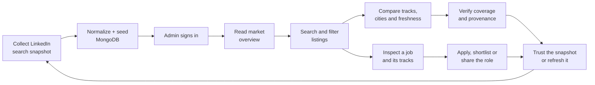

The loop matters: JobLens is not a one-off report. Teams collect a snapshot, inspect it, act on it, then refresh the dataset and repeat the process.

### How Teams Use It

1. **Collect a snapshot.** A teammate collects LinkedIn search results into the supported JSON files outside the app.
2. **Seed the database.** Run `npm run seed` to normalize, de-duplicate and replace the current snapshot.
3. **Read the market.** Open the Overview to see totals, tracks, freshness and coverage before drilling into individual roles.
4. **Investigate.** Use search, track chips, location filters and sorting to answer a specific question.
5. **Verify.** Check the Dataset page to confirm the collection was complete and understand its scope.
6. **Act.** Open a listing drawer and use the apply or original LinkedIn link.
7. **Refresh.** When the market moves, collect a new snapshot and repeat; the console always reflects the latest seed.

### Product Scope

| In scope | Out of scope |
| --- | --- |
| Read-only exploration of collected LinkedIn listings | Scraping LinkedIn inside the running application |
| Fresher and generic job listings from supported JSON sources | Real-time job feeds or live listing synchronization |
| Admin authentication with an email allowlist | Public sign-up, multi-tenant accounts or per-user roles |
| Overview, listings, analytics and dataset provenance | Editing, deleting or creating listings from the UI |
| Aggregated counts, facets and freshness buckets | Applicant tracking, applications, notes or recruiter CRM workflows |
| Card, table and drawer views | Resume parsing, matching or candidate recommendations |
| Vercel, Docker and Node-host deployment | Mobile native applications |

### Value Proposition

| Outcome | How the product delivers it |
| --- | --- |
| **Visibility** | One dashboard replaces manual reading of raw exports and ad-hoc spreadsheets |
| **Speed** | Pre-aggregated API responses make common market questions immediate |
| **Trust** | Provenance, collection notes and per-search coverage make the data auditable |
| **Focus** | Fresher-specific fields and role-track filters keep attention on relevant opportunities |
| **Reusability** | The same REST API can power future tools beyond this dashboard |
| **Low overhead** | Small dependency surface, one database and a repeatable seeding workflow |

### Success Measures

| Measure | Why it matters | Where to observe it |
| --- | --- | --- |
| **Snapshot freshness** | Stale data leads to bad decisions | `collected_at` and `posted_hours` across Overview and Dataset |
| **Search coverage** | Missing searches silently shrink the dataset | Coverage ring on Overview; search status log on Dataset |
| **Record validity** | Invalid dates or duplicates distort counts | Seed output (imported vs. skipped rows) and record totals |
| **Answer speed** | The console should replace file spelunking | Time to answer a market question using filters and analytics |
| **Access reliability** | The console must be available when decisions are made | `/api/health` and deployment uptime checks |
| **Data reuse** | A stable API enables other internal tools | Authenticated `/api/jobs` and `/api/overview` usage |

## Feature Highlights

| Area | Capabilities |
| --- | --- |
| **Authentication** | Admin email allowlist, shared password, signed JWT sessions (12-hour expiry), protected API routes, automatic session invalidation on `401` |
| **Overview** | Live listing count, hiring company count, average posting freshness, dual-track roles, search-coverage ring, role-track bars, freshness columns, top locations, primary-search donut, recent listings |
| **Job browser** | Debounced full-text search (title/company/location), role-track chips, location filter, five sort modes, card and table views, pagination, empty/error states |
| **Job details** | Slide-over drawer with company avatar, location, posted time, matched search tracks, ranking position per search track, apply and original LinkedIn links |
| **Analytics** | Top hiring track, strongest location, top primary search, share of roles posted in the last 3 hours, track distribution, search mix, location concentration, freshness curve, per-search coverage log |
| **Dataset provenance** | Collection time, seed time, source file, record counts, collection filters, timezone, source reference, search status log, scope notes |
| **Resilience** | Request-cancellation guards, skeleton loaders, retryable error cards, shared 30-second clock for relative timestamps |
| **Deployment** | Vercel-ready rewrite config, serverless-safe DB connection reuse, multi-stage Dockerfile for container hosts |

## Screenshots

> Captured from the running application with the seeded dataset.

<table>
  <tr>
    <td width="50%" align="center"><strong>Admin sign in</strong><br/><br/>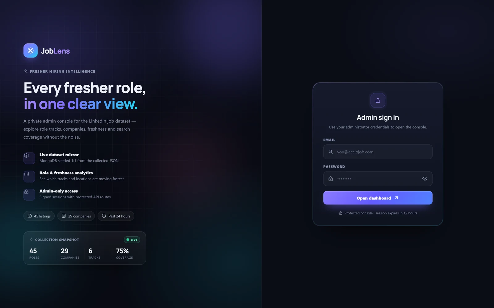</td>
    <td width="50%" align="center"><strong>Market overview</strong><br/><br/>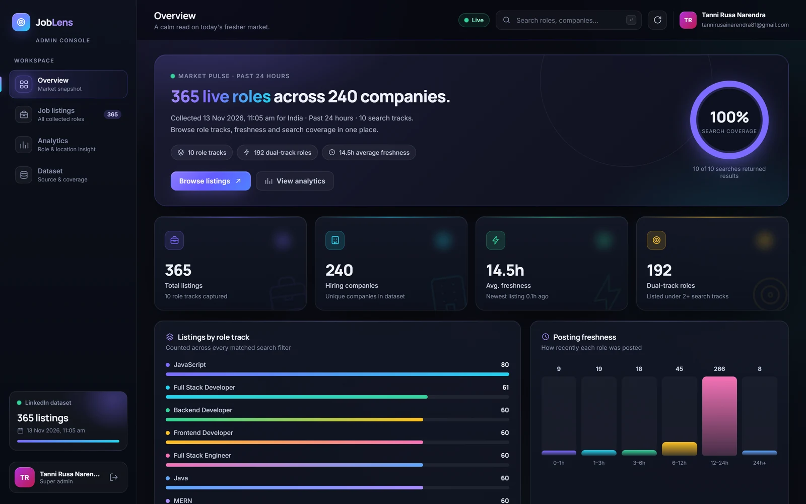</td>
  </tr>
  <tr>
    <td align="center"><strong>Job listings — card view</strong><br/><br/>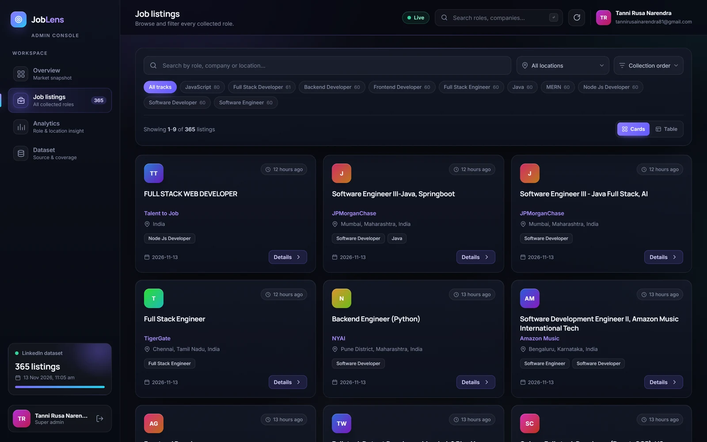</td>
    <td align="center"><strong>Job detail drawer</strong><br/><br/>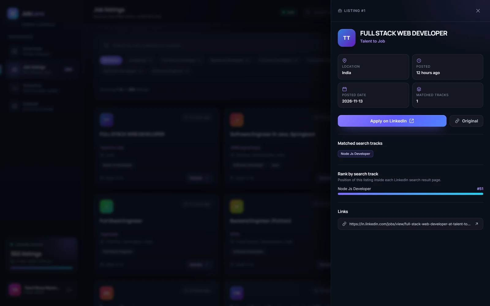</td>
  </tr>
  <tr>
    <td align="center"><strong>Job listings — table view</strong><br/><br/>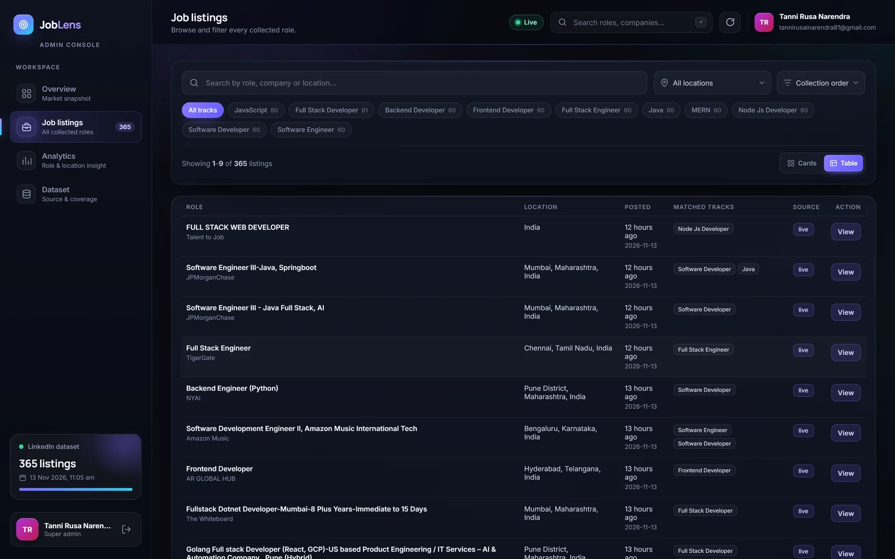</td>
    <td align="center"><strong>Analytics</strong><br/><br/>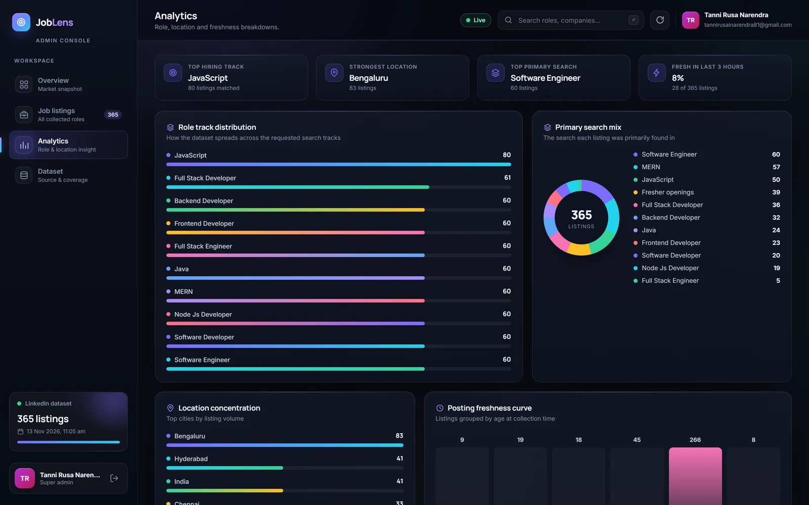</td>
  </tr>
  <tr>
    <td align="center"><strong>Dataset &amp; coverage</strong><br/><br/>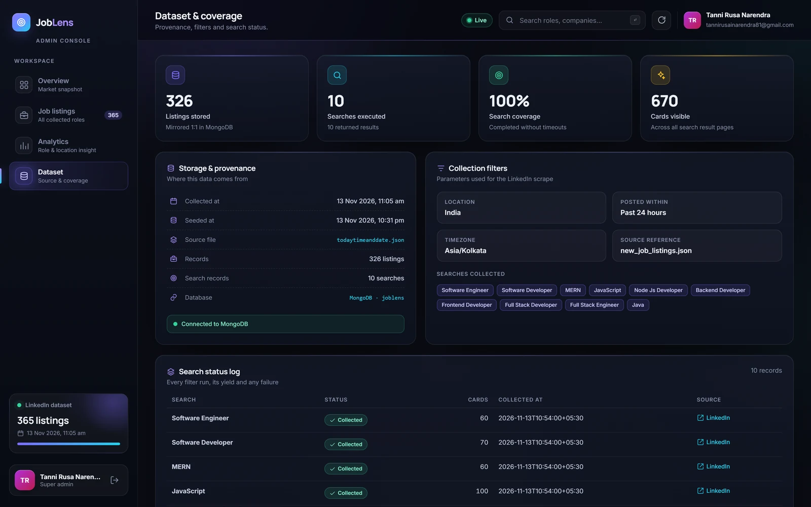</td>
    <td align="center"><strong>Brand mark</strong><br/><br/></td>
  </tr>
</table>

<details>
<summary><strong>Full-page captures</strong></summary>

<br />

| Overview | Analytics | Dataset |
| --- | --- | --- |
| 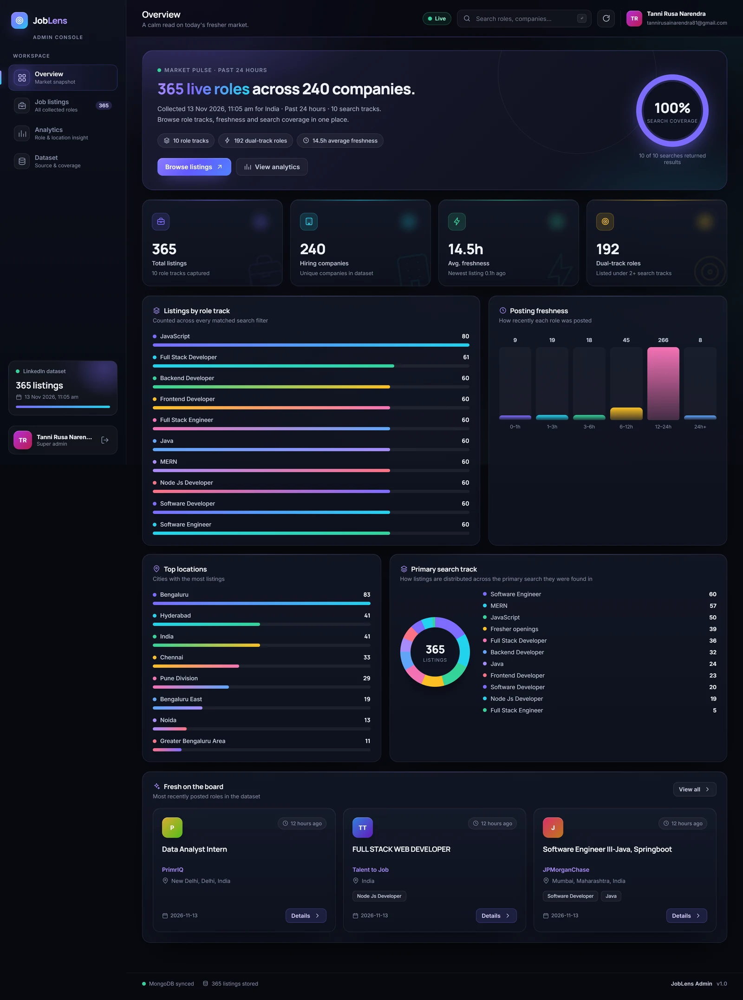 | 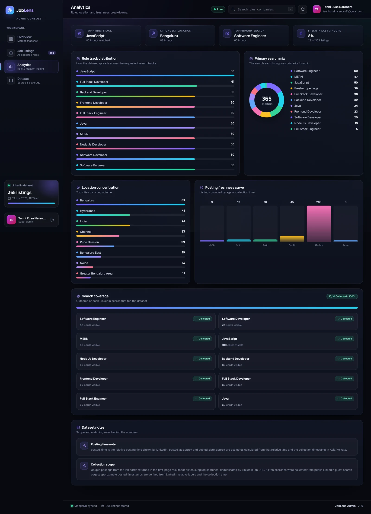 | 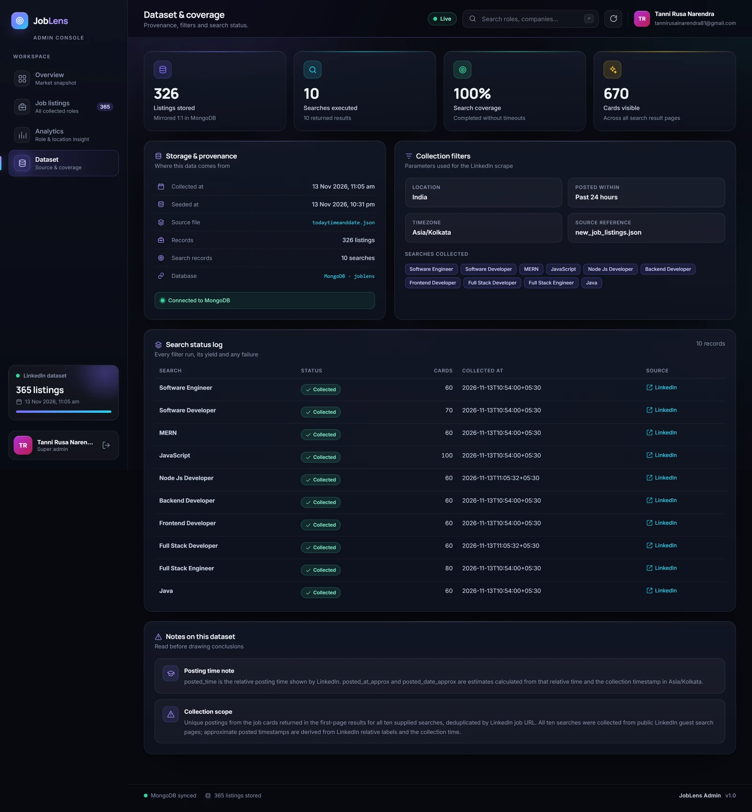 |

</details>

## Tech Stack

| Layer | Technology | Notes |
| --- | --- | --- |
| **UI** | React 18 | Function components, hooks, context, `useSyncExternalStore` |
| **Build** | Vite 6 | Dev server on port `5173`, `/api` proxy, production build in `dist/` |
| **Styling** | Hand-written CSS | Single global stylesheet, CSS custom properties, no UI framework |
| **API** | Node.js 22 + Express 4 | REST, JSON, CORS, static SPA fallback |
| **Database** | MongoDB + Mongoose 8 | `jobs` and `datasets` collections, aggregation pipelines, indexes |
| **Auth** | `jsonwebtoken` | HS256 bearer tokens, 12-hour expiry, allowlist + shared password |
| **Config** | `dotenv` | `.env` locally, platform environment variables in production |
| **Dev tooling** | `concurrently` | Runs API and Vite together |
| **Deployment** | Vercel or Docker | Serverless handler at `api/index.js`; multi-stage image included |

---

## Technical Documentation

This section explains how JobLens is engineered: its design goals, architecture, data pipeline, frontend and backend internals, security model, quality strategy, operations and extension points. It is written for engineers who need to review, operate or extend the codebase.

### Engineering Goals and Constraints

| Goal or constraint | Implication | How the implementation responds |
| --- | --- | --- |
| **One deployable codebase** | The UI and API must ship together without separate services | The Express app is exported from `server/index.js`; `api/index.js` adapts it for Vercel |
| **Serverless compatible** | No reliance on long-lived process memory | Database connection is lazily created and its promise cached per function instance |
| **Read-heavy, read-only workload** | Queries must be fast and bounded | Indexed fields, aggregation pipelines, pagination caps and top-N limits |
| **No runtime scraping** | Data collection is external to the app | A CLI seeder imports pre-collected JSON snapshots |
| **Small dependency surface** | Fewer packages to audit and maintain | No router, no chart library, no UI framework, no state library |
| **Private access** | Unaided URLs must not expose data | Admin allowlist, shared password and JWT verification on every data route |
| **Deterministic normalization** | The same source JSON must produce the same records | Pure parsing/derivation helpers in `server/seed.js` and a de-duplication map |
| **Fast local onboarding** | A new developer should run one command | `npm run dev` runs the API and Vite together; Vite proxies `/api` |
| **Portable deployment** | Support hosted and self-managed environments | Vercel config, multi-stage Dockerfile and plain `npm start` |
| **Responsive, low-bandwidth UI** | The console should stay usable on smaller screens and slow links | Compact payloads, skeleton states, responsive CSS, WebP screenshots in docs |

### Technology Decisions

| Decision | Choice | Rationale | Trade-off |
| --- | --- | --- | --- |
| **Frontend framework** | React 18 | Component model maps cleanly to dashboard sections; hooks cover all state needs | No server-side rendering |
| **Build tooling** | Vite 6 | Fast HMR, minimal config, built-in dev proxy and simple production output | SPA-only output; no framework-level data loading |
| **Routing** | Conditional page rendering in `Shell` | Zero routing dependency; instant navigation; state survives page switches | No deep links, browser back/forward support or shareable page URLs |
| **Styling** | One global `styles.css` | Full control over the custom dark theme; no design-system dependency | Large stylesheet; no CSS modules or scoping |
| **API framework** | Express 4 | Minimal, familiar and easy to adapt to both server and serverless runtimes | Validation and serialization are manual |
| **Database** | MongoDB | Listings contain arrays (`matched_searches`) and maps (`positions_by_search`) that fit document storage | No relational constraints; aggregation logic must be maintained in code |
| **ODM** | Mongoose 8 | Schemas, defaults, indexes and casting with little boilerplate | Mixed types (dataset filters) are not strongly validated |
| **Authentication** | JWT + email allowlist + shared password | Sufficient for a small internal console; no identity provider required | No per-user accounts, revocation list or granular roles |
| **Session transport** | Bearer token in `localStorage` | Simple SPA integration; works identically on Vercel and Docker | Token is readable by JavaScript, so XSS protection matters |
| **Data loading** | CLI seeder, destructive replace | Produces a clean, reproducible snapshot and avoids merge complexity | Manual refresh; no incremental ingestion |
| **Client state** | Context for auth, local state for pages | Avoids Redux/Zustand for a small app | Some state ownership is centralised in `Shell` |
| **Charts** | Hand-built CSS/SVG primitives | Keeps the bundle small and the visual language consistent | Only the chart types implemented in `ui.jsx` are available |
| **Time display** | Shared `useSyncExternalStore` clock | One interval for all relative timestamps | Timestamps refresh every 30 seconds rather than continuously |
| **Deployment** | Vercel serverless and Docker | Covers the managed and self-hosted cases with one codebase | Cold starts and platform limits apply on serverless |

### Code Organization and Conventions

The repository separates **runtime code**, **deployment adapters** and **documentation**:

| Area | Responsibility |
| --- | --- |
| `server/` | Express application, models, auth middleware and seed pipeline |
| `api/` | Deployment adapter that connects to MongoDB and delegates to the Express app |
| `src/` | React application: pages, components, context, utilities and styles |
| `docs/` | Banner and captured screenshots referenced by this README |
| Root config | Vite, Vercel, Docker, environment template and package metadata |

Conventions used throughout the codebase:

- **ES modules only.** `"type": "module"` is set, and both backend and frontend use `import`/`export`.
- **Formatting.** Single quotes, no semicolons, two-space indentation, trailing commas in multiline literals.
- **Components.** PascalCase `.jsx` files; function components with hooks; props passed explicitly and destructured in the signature.
- **Backend layout.** Routes live in `server/index.js`, cross-cutting request logic in `server/middleware/`, persistence in `server/models/`, and connection setup in `server/db.js`.
- **Frontend layering.** `pages/` compose feature UI, `components/ui.jsx` holds reusable primitives, `components/` holds feature components, `lib/` holds network and formatting helpers, and `context/` holds session state.
- **Naming.** `camelCase` for variables and functions, `PascalCase` for components and models, `SCREAMING_SNAKE_CASE` for constants, and `snake_case` for persisted fields to mirror the source JSON.
- **Data contracts.** API responses reuse the MongoDB field names directly; the client consumes `snake_case` fields rather than maintaining a mapping layer.
- **Errors.** The client wrapper throws `Error` objects with human-readable messages; the server returns `{ "error": "..." }` JSON with an HTTP status.
- **Self-describing code.** Functions and variables carry the intent; comments are intentionally rare. New code should follow the same style.

### High-Level System Architecture

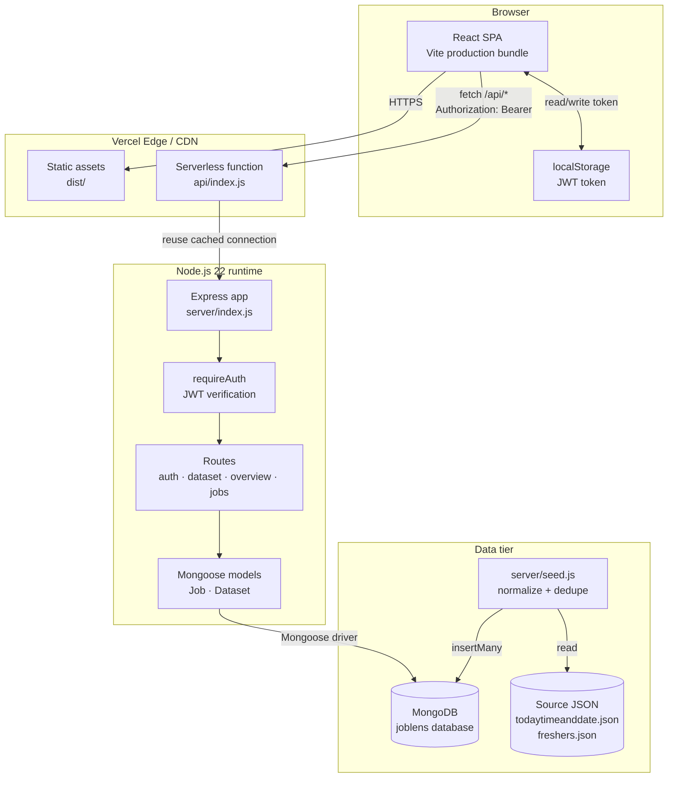

The frontend never talks to MongoDB directly. Every read passes through the API, and every data endpoint (except `/api/health` and the login route) requires a valid bearer token. On Vercel, the static SPA is served from the CDN while `/api/*` is rewritten to a single serverless function that reuses a cached Mongoose connection across warm invocations.

### Frontend Architecture

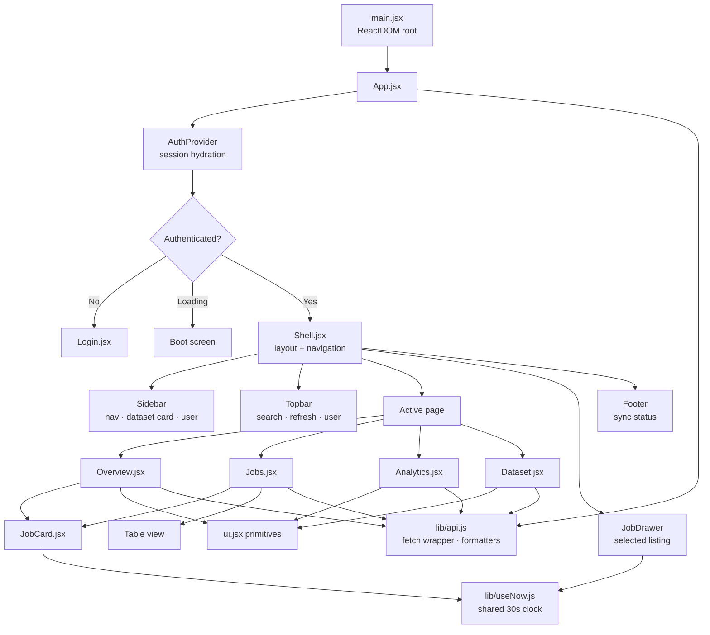

`AuthProvider` owns the session lifecycle. On boot it reads the token from `localStorage` and calls `/api/auth/me`; if the call fails, the user is returned to the login screen. `Shell` is the single source of truth for the active page, refresh key, global search seed, selected job and the dataset summary shown in the sidebar. Pages are rendered conditionally rather than through a router, keeping the bundle small and navigation instant.

The `api()` helper centralises three behaviours:

1. Attaches `Content-Type: application/json` when a body exists.
2. Attaches `Authorization: Bearer <token>` when a token is stored.
3. Clears the token and emits `joblens:unauthorized` on any `401`, which `AuthProvider` listens for.

`useNow()` uses `useSyncExternalStore` to share a **single 30-second interval** across every card and drawer that renders relative timestamps, instead of starting one timer per component.

### Frontend Engineering Details

#### State ownership

| State | Owner | Lifetime | Notes |
| --- | --- | --- | --- |
| Session token | `localStorage` + `AuthContext` | Persists until logout, expiry or `401` | Only persisted client state |
| User profile | `AuthContext` | Hydrated from `/api/auth/me` on boot | Cleared by the `joblens:unauthorized` event |
| Active page | `Shell` | Component lifetime | Conditional rendering, not a URL route |
| Refresh key | `Shell` | Component lifetime | Incremented to force pages to refetch |
| Global search seed | `Shell` → `Jobs` | Until the next global search | Passed as `{ q, key }`; the `key` change triggers the page effect |
| Selected job | `Shell` | Until the drawer closes | Passed to `JobDrawer` |
| Sidebar / refreshing UI flags | `Shell` | Component lifetime | Presentation only |
| Dataset summary | `Shell` | Refetched per refresh key | Powers the sidebar dataset card and listing badge |
| Query, filters, page, data, loading, error | Individual page | Page lifetime | Reset when `Shell` remounts content with `key={page}` |

The rule is simple: **server state stays local to the page that fetches it**. There is no global cache, query client or store. Refreshes propagate by incrementing `refreshKey`, and a page remount intentionally resets its filters.

#### Data fetching lifecycle

1. A page effect sets an `error` to empty and starts a fetch through `api()`.
2. A `cancelled` flag is captured. When the effect is cleaned up, late responses are ignored.
3. On success, the payload is stored. On failure, the message is stored and surfaced through `ErrorNote`.
4. `finally` clears loading only if the effect is still current.
5. Search input is debounced for 300 ms; filter and sort changes reset pagination to page 1.

The `api()` wrapper is deliberately small:

```js
const res = await fetch(path, { ...options, headers })
const data = await res.json().catch(() => ({}))
if (res.status === 401) {
  setToken(null)
  window.dispatchEvent(new CustomEvent('joblens:unauthorized'))
  throw new Error(data.error || 'Unauthorized')
}
```

This gives every caller identical token handling, JSON error parsing and session-expiry behaviour.

#### Rendering pipeline

- `App` decides between the boot screen, `Login` and `Shell`.
- `Shell` renders exactly one page at a time inside `<main key={page}>`, so page-local state does not leak across navigation.
- Lists use stable keys: `_id` for jobs, `name` for facet items and `label` for chart buckets.
- Loading states use layout-matched skeletons rather than spinners.
- `ErrorNote` offers a retry that increments a local reload counter.
- `EmptyState` distinguishes “no data yet” from “no results for these filters”.

#### Component contracts

| Component | Inputs | Responsibility |
| --- | --- | --- |
| `Shell` | none (uses `useAuth`) | Layout, navigation, refresh orchestration, global search, drawer selection |
| `Overview` | `refreshKey`, `onOpenJob`, `onNavigate` | Fetch and render market snapshot |
| `Jobs` | `refreshKey`, `seed`, `onOpenJob` | Fetch and render searchable listing browser |
| `Analytics` | `refreshKey` | Fetch and render distribution and coverage views |
| `Dataset` | `refreshKey` | Fetch and render provenance and search log |
| `JobCard` | `job`, `onOpen`, `index` | Compact listing summary with freshness indicator |
| `JobDrawer` | `job`, `onClose` | Full listing detail, track ranking, external links |
| `SectionCard` | `title`, `hint`, `action`, `icon`, `className`, `children` | Consistent panel chrome |
| `StatCard` | `icon`, `label`, `value`, `foot`, `tone`, `loading` | KPI tile |
| `BarList` / `ColumnChart` / `Donut` | `items`, plus chart-specific props | Dependency-free visualisations |
| `ErrorNote` / `EmptyState` / `SkeletonCards` | Message, retry or count props | Failure, empty and loading states |

#### Styling system

- A single global stylesheet defines the dark palette, spacing, gradients, shadows and responsive breakpoints with CSS custom properties.
- Class naming is BEM-like: block (`job-card`), element (`job-card__title`) and modifier (`is-active`, `tone-violet`). State classes use `is-` prefixes.
- Layouts use CSS grid and flexbox; the sidebar collapses behind an overlay on narrow screens.
- Animations are CSS transitions and keyframes; `prefers-reduced-motion` is not yet handled.

#### Accessibility posture

- Form fields are wrapped in `<label>` elements; icon-only buttons carry `aria-label`.
- The view toggle uses `role="group"` and `aria-pressed`.
- `Escape` closes the job drawer and restores body scrolling.
- Charts expose textual counts next to visual bars, but there are no chart `<table>` alternatives.
- Known gaps: the drawer does not trap or restore focus, and there are no live regions for asynchronous status announcements.

#### Bundle profile

The production build is intentionally lean:

```text
dist/index.html                 0.52 kB   │ gzip:  0.33 kB
dist/assets/index-*.css        47.77 kB   │ gzip:  9.89 kB
dist/assets/index-*.js        195.49 kB   │ gzip: 59.29 kB
```

No router, chart library, icon package or state-management library is shipped.

### Backend Architecture

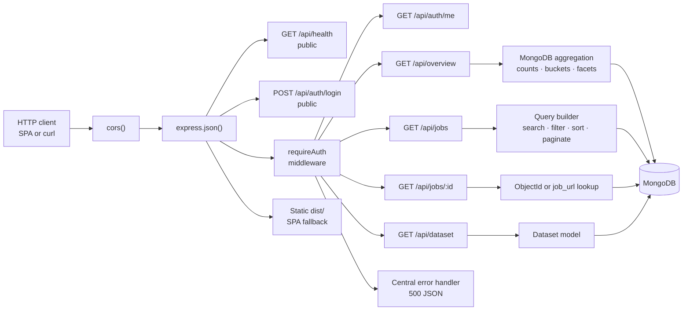

Key backend decisions:

- **Dual runtime**: `server/index.js` exports `app`; it only calls `listen()` when executed directly (`isDirectRun`). `api/index.js` imports the same app and wraps it with a lazy, cached `connectDb()` promise for serverless reuse.
- **Defence in depth**: the login route validates the email against an allowlist before issuing a token; `requireAuth` verifies signature and expiry on every protected request.
- **Aggregation at the database**: counts, facet buckets and freshness distributions are computed in MongoDB rather than in Node or the browser.
- **Static hosting fallback**: if `dist/` exists, Express serves the built SPA and sends `index.html` for any non-API route.

### Backend Engineering Details

#### Middleware and request pipeline

Requests flow through the Express app in this order:

1. `cors()` — permissive by default so local development and previews work without extra configuration.
2. `express.json()` — parses JSON bodies for the login route.
3. **Public routes** — `GET /api/health`, `POST /api/auth/login`.
4. **Protected routes** — `requireAuth` verifies the bearer token before `/api/auth/me`, `/api/dataset`, `/api/overview`, `/api/jobs` and `/api/jobs/:id`.
5. **Static hosting** — when `dist/` exists, static assets are served and non-API routes fall back to `index.html`.
6. **Error middleware** — logs the error and returns a generic `500` JSON payload.

#### Route implementation matrix

| Route | Data access | Notes |
| --- | --- | --- |
| `GET /api/health` | Mongoose connection state only | No database round trip |
| `POST /api/auth/login` | Environment variables only | Issues a JWT; no user collection exists |
| `GET /api/auth/me` | Decoded `req.user` | Confirms a session without another lookup |
| `GET /api/dataset` | `Dataset.findOne` + `Job.countDocuments` | Runs both in parallel |
| `GET /api/overview` | Nine parallel queries/aggregations | Single round trip for Overview and Analytics |
| `GET /api/jobs` | `find` + `countDocuments` + two facet aggregations | All four queries run in parallel |
| `GET /api/jobs/:id` | `findById` or `findOne({ job_url })` | Chooses the lookup based on ObjectId validity |

#### Query construction

- `escapeRegex()` neutralises regex metacharacters before building the search pattern.
- `q` becomes an `$or` across `title`, `company` and `location`.
- `filter` performs an exact match against the `matched_searches` array.
- `location` appends `city`, `region`, `location` and `search_keyword` patterns to the same `$or` array. **Search text and location therefore behave as a union rather than an intersection**; a future revision should wrap them with `$and` if combined filtering is required.
- Sorting is restricted to a whitelist of five sort objects, with `order` as the fallback.
- `page` is coerced to an integer and floored at `1`; `limit` is clamped to `1–50`.
- The count and facet aggregations intentionally ignore the active filters so the filter chips and location options remain stable while browsing.

#### Aggregation strategy

- **Role-track facets** unwind `matched_searches` and group by track name, sorted by descending count.
- **Location facets** group by `city`; the overview keeps the top 8 while the jobs endpoint keeps the top 20.
- **Dual-track count** uses `{ 'matched_searches.1': { $exists: true } }` to count listings matched by at least two tracks.
- **Freshness buckets** project only `posted_hours`, then bucket in Node across `0–1h`, `1–3h`, `3–6h`, `6–12h`, `12–24h` and `24h+`.
- **Average freshness** is rounded to one decimal place.
- **Search summary** is derived from the dataset provenance document rather than from the listings, keeping coverage tied to the collection run.

#### Connection lifecycle

- `server/db.js` enables `strictQuery`, sets an 8-second server-selection timeout and connects with `mongoose.connect`.
- Locally, the process connects **before** `app.listen()` and exits if the connection fails.
- On Vercel, `api/index.js` caches the connection promise. A rejection resets the promise so the next invocation can retry.
- Mongoose reuses the underlying connection across warm serverless invocations; the platform manages final teardown.

#### Static hosting and SPA fallback

If `dist/` exists when the server starts, Express mounts it and serves `index.html` for any path that does not begin with `/api`. The check happens once at startup, so a build created **after** the server starts is not picked up until restart. In API-only deployments without `dist/`, the server simply exposes the API.

#### Validation and error semantics

- Login validation is intentionally narrow: identifier present, allowlisted, password exactly equal to `ADMIN_PASSWORD`.
- Query parameters are parsed defensively and clamped rather than rejected.
- There is no schema-validation library for request bodies because the only body is the login payload.
- The central error middleware handles synchronous throws and logs unexpected failures.
- **Known gap:** under Express 4, rejected promises from `async` route handlers are not automatically forwarded to the error middleware. A wrapper such as `express-async-errors` or explicit `try/catch` blocks is recommended before relying on centralized handling for database failures.
- The serverless adapter separately catches connection failures and returns a `500` with `{ "error": "Database connection failed" }`.

#### Testability notes

- `parsePostedHours`, `parsePostedAt`, `parsePostedDate`, `deriveLocation` and `normalizeListing` are deterministic and can be unit tested directly once exported.
- Route handlers currently talk to Mongoose models directly; extracting query/service functions would make integration testing easier.
- The seed pipeline can be tested with fixture JSON and an in-memory or disposable database without touching the production dataset.

### Authentication and Request Flow

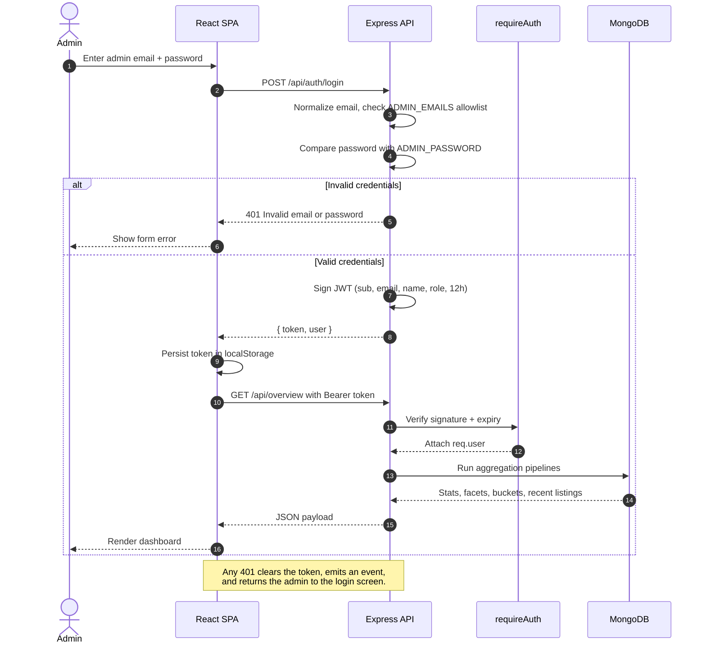

The JWT payload has the shape:

```json
{
  "sub": "admin@example.com",
  "email": "admin@example.com",
  "name": "Admin",
  "role": "admin",
  "iat": 1763000000,
  "exp": 1763043200
}
```

### Data Ingestion Pipeline

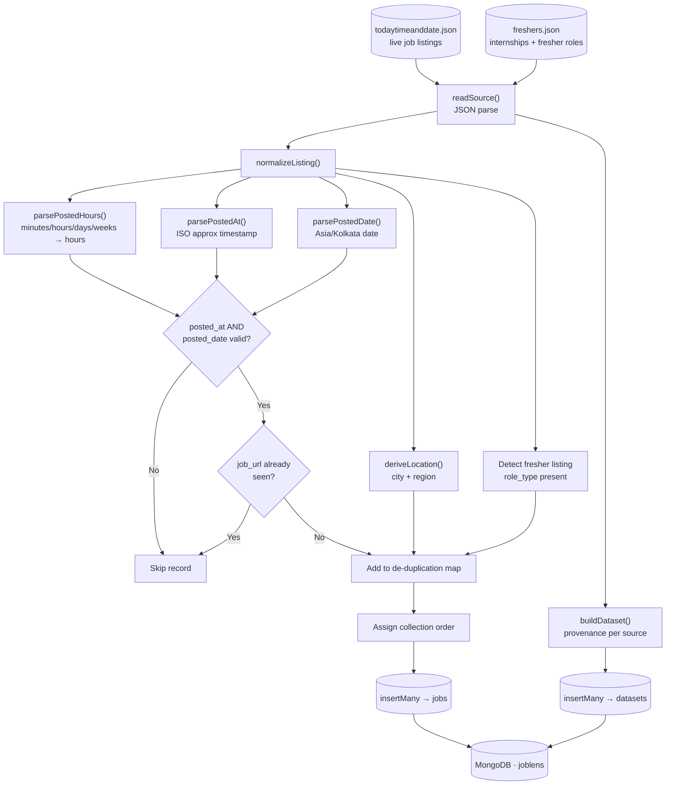

The seeder is intentionally destructive: it deletes the existing `jobs` and `datasets` documents before inserting a fresh snapshot. It reads only `todaytimeanddate.json` and `freshers.json`; the other JSON files in the repository are raw collection artifacts kept for reference.

Normalization rules:

- `posted_time` strings such as `"10 minutes ago"`, `"3 hours ago"` or `"2 days ago"` are converted into decimal `posted_hours`.
- `posted_at` comes from `posted_at_approx`; `posted_date` is parsed at midnight in `Asia/Kolkata`.
- `location` is split on commas into `city` and `region`.
- Listings are de-duplicated by `job_url`; the first occurrence wins.
- Fresher records get `listing_type: "fresher"` and a fallback search track of `Fresher openings`.
- `primary_search` is the first matched search, then `search_keyword`, then `Fresher openings`, then `Unclassified`.

### Data Model

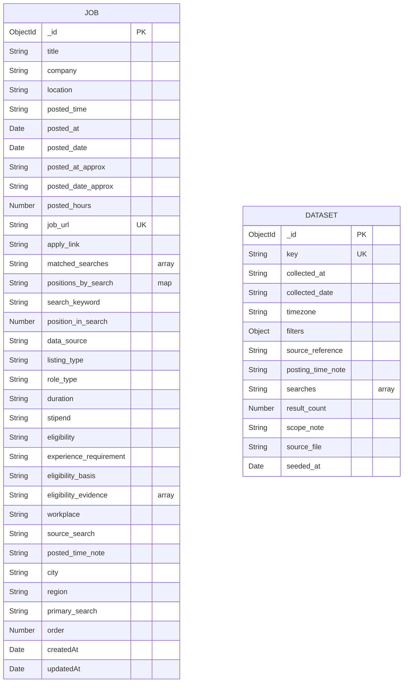

There is no hard foreign key between `Job` and `Dataset`; the relationship is logical, through the source file and collection run recorded in the dataset provenance document. Each `Dataset.searches[]` entry captures the keyword, source URL, visible card count, collection flag and collection timestamp.

#### `jobs` indexes

| Index | Purpose |
| --- | --- |
| `title`, `company`, `location` (text) | Full-text search |
| `order` | Default collection-order sorting |
| `posted_hours` | Freshness sorting and buckets |
| `posted_at`, `posted_date` | Recency queries |
| `matched_searches` | Role-track filtering and facet aggregation |
| `search_keyword` | Primary-search analytics |
| `data_source` | Source breakdowns |
| `listing_type` | Job vs. fresher filtering |
| `job_url` (unique) | De-duplication |

### Module Dependency Map

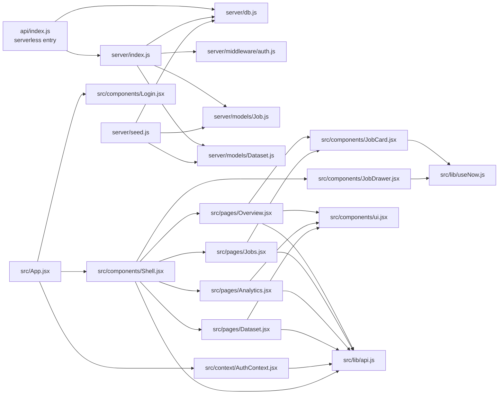

### API Design Conventions

JobLens exposes a small, deliberately consistent REST surface:

| Convention | Implementation |
| --- | --- |
| **Base path** | Every route is under `/api` |
| **Resource naming** | Nouns (`/jobs`, `/dataset`, `/overview`); no verbs except `/auth/login` and `/health` |
| **HTTP methods** | `GET` for all reads; a single `POST` for login. No write endpoints exist for job data |
| **Authentication** | `Authorization: Bearer <jwt>` on every route except health and login |
| **Content type** | JSON request and response bodies |
| **Single-resource responses** | Return the object directly (for example, a job or dataset document) |
| **Collection responses** | Use an envelope: `items`, `total`, `page`, `pages`, `limit` |
| **Facets** | Included in the `/jobs` response to avoid a second round trip |
| **Errors** | Always `{ "error": "Human-readable message" }` |
| **Status codes** | `200` success, `401` unauthenticated/expired, `404` unknown job, `500` unexpected server failure |
| **Sorting** | Whitelisted enum values only; unknown values fall back to `order` |
| **Bounds** | `limit` clamped to `1–50`; `page` floored at `1` |
| **Field naming** | Persisted and returned fields use `snake_case` to mirror the source JSON |
| **Versioning** | No version prefix; prefer additive changes over breaking changes |
| **Read safety** | All data endpoints are idempotent and side-effect free |

The frontend depends on these shapes directly, so any field rename is an API contract change and should be treated as such.

### Error Handling and Failure Modes

| Failure | Detection | Current behaviour | Recovery |
| --- | --- | --- | --- |
| **MongoDB unreachable at server boot** | `connectDb()` rejects | Process logs the error and exits | Fix `MONGODB_URI` or network access, then restart |
| **MongoDB unreachable in serverless** | `ensureDb()` rejects | `500` with `{ "error": "Database connection failed" }`; promise resets | Next invocation retries naturally |
| **Database error inside an async route** | Rejected promise | Express 4 may not forward it to the error middleware (known gap) | Add `try/catch` or an async wrapper; inspect function logs |
| **Missing bearer token** | `requireAuth` | `401 Authentication required` | Sign in |
| **Invalid or expired token** | `jwt.verify()` throws | `401 Session expired...`; client clears the token and emits an event | Return to login |
| **Wrong email or password** | Login route comparison | `401 Invalid email or password` | Retry with allowlisted credentials |
| **Unknown job id or URL** | Lookup returns `null` | `404 Job not found` | Verify the identifier |
| **No listings in the database** | Empty query result | UI renders the empty state | Run `npm run seed` |
| **Missing dataset document** | `findOne` returns `null` | API returns an object with `total_listings`; UI shows placeholders | Re-run the seed |
| **Network/fetch failure** | `fetch` rejects | Page shows `ErrorNote` with a retry action | Retry or check connectivity |
| **Invalid query parameters** | Parsing returns `NaN`/unknown values | Values are clamped or fall back to defaults | No action required |
| **Invalid or duplicate seed rows** | Date validation and URL map | Rows are skipped before insertion | Inspect seed counts and source data |
| **Mongoose validation during seed** | `insertMany` rejects | Seed exits with an error | Fix the offending rows and re-seed |

### Performance and Scalability

The current implementation is optimised for **hundreds to low thousands of listings**, which matches the collected snapshots. It keeps queries bounded and avoids shipping raw collections to the browser.

| Mechanism | Where | Effect |
| --- | --- | --- |
| **Indexed fields** | `server/models/Job.js` | Supports sorting, filtering and uniqueness checks |
| **Parallel queries** | Overview and jobs routes | Multiple aggregations run concurrently with `Promise.all` |
| **Pagination** | `/api/jobs` | Bounded response size; `limit` capped at 50 |
| **Top-N limits** | Location facets | Overview keeps 8 cities, jobs keeps 20 |
| **Projection** | Freshness aggregation | Reads only `posted_hours` for bucket calculation |
| **Connection reuse** | `api/index.js` | Warm serverless invocations reuse the Mongoose connection |
| **Debounced search** | `Jobs.jsx` | Prevents a request per keystroke |
| **Stale-response guards** | Page effects | Avoids rendering out-of-order responses |
| **Static SPA delivery** | Vercel CDN / Express static | UI assets are cheap to serve |

Known bottlenecks and scaling paths:

- **Regex search is not index-backed.** `/api/jobs` uses case-insensitive regular expressions with wildcards, so MongoDB cannot use the text index for `q`. At larger volumes, switch to `$text` or Atlas Search and add relevance sorting.
- **Overview aggregations scan the collection.** Every `/api/overview` request recomputes counts and buckets. Materialize them during seeding or cache the response with a short TTL.
- **Facets are recomputed per listing request.** Cache facet aggregations or compute them from a materialized summary.
- **The seeder is a full replacement.** It loads all normalized documents into memory before `insertMany`. For much larger datasets, stream batches and keep versioned snapshots.
- **No HTTP caching layer.** Conditional requests, ETags and CDN caching for public assets are the natural next step.
- **Combined filters use a union.** As noted above, `q` and `location` share an `$or` array; use `$and` when intersection semantics are required.

### Security Engineering

**Threat model.** The primary risks are unauthorised access to the dataset, credential guessing, token theft through cross-site scripting, regex-based query abuse, secret leakage and accidental public exposure of the admin console.

| Control | Implementation |
| --- | --- |
| **Access control** | Email allowlist (`ADMIN_EMAILS`) plus shared password |
| **Session integrity** | Signed JWT with a 12-hour expiry; verified on every protected request |
| **Token transport** | Bearer header, not a cookie, which reduces CSRF exposure |
| **Input handling** | Regex metacharacters escaped; pagination and limit values clamped |
| **Secret handling** | `.env` is git-ignored; production values live in the platform's environment settings |
| **Least data exposure** | Read-only routes; no raw collection dump; only documented aggregates are returned |
| **Transport** | TLS terminated by Vercel, Docker reverse proxy or the hosting platform |
| **Session revocation** | Client-side token removal on `401`; rotating `JWT_SECRET` invalidates all sessions |

Known gaps, documented in more detail in [Security Notes](#security-notes):

- Shared password rather than per-user credentials.
- No login rate limiting, lockout or audit trail.
- Permissive CORS (`cors()` with defaults).
- Token stored in `localStorage`, which is accessible to any injected script.
- No `helmet`, Content Security Policy or security headers.
- No dependency or container scanning in the current workflow.

### Testing and Quality

The repository currently relies on build-time and manual verification rather than an automated test suite.

| Check | How it is performed today | Status |
| --- | --- | --- |
| Frontend compilation | `npm run build` | Available |
| API and database health | `GET /api/health` | Available |
| Seed correctness | Seeder logs imported/skipped counts | Available |
| Documentation diagrams | Mermaid parse validation | Verified during authoring |
| Visual regression | Manual screenshot capture | Manual |
| Unit tests | — | Not yet implemented |
| Integration tests | — | Not yet implemented |
| End-to-end tests | — | Not yet implemented |
| Linting / formatting | — | No configured script |

Recommended test pyramid:

| Level | Targets | Suggested tooling |
| --- | --- | --- |
| **Unit** | `parsePostedHours`, `parsePostedAt`, `parsePostedDate`, `deriveLocation`, `normalizeListing`, `escapeRegex` | Vitest or Node's test runner |
| **Integration** | Route behaviour against a disposable database, including auth and facets | Supertest + `mongodb-memory-server` |
| **Contract** | `/api/jobs`, `/api/overview` and `/api/dataset` response shapes | Schema assertions or Zod |
| **End-to-end** | Login → overview → filter → drawer → dataset | Playwright |
| **Load** | Overview and jobs under realistic collection sizes | k6 or autocannon |

Test data should be deterministic: use fixture JSON, freeze the clock for relative-time assertions and pin the `Asia/Kolkata` timezone. A PR quality gate should require a passing build, protected-route checks and updated documentation for any API change.

### Observability and Operations

Current observability is intentionally minimal:

| Signal | Availability |
| --- | --- |
| **Health endpoint** | `GET /api/health` reports API liveness and MongoDB connection state |
| **Startup log** | `JobLens API listening on http://localhost:<port>` |
| **Seed logs** | Imported count, skipped count and database name |
| **Error logs** | Central error middleware logs unexpected errors; serverless adapter logs connection failures |
| **Request logs** | Not implemented |
| **Metrics and tracing** | Not implemented |
| **Alerting** | Not implemented |

Operational runbook:

| Symptom | Checks | Action |
| --- | --- | --- |
| Login always fails | `ADMIN_EMAILS`, `ADMIN_PASSWORD`, `.env` loaded, process restarted | Correct credentials and restart |
| Dashboard is empty | Seed completed, `MONGODB_URI` points to the expected database | Run `npm run seed` |
| `/api/health` reports disconnected | Atlas status, IP allowlist, credentials, network egress | Restore connectivity and redeploy |
| `500` responses | Function/server logs, database status, query errors | Fix the underlying error; restart or redeploy |
| Data looks stale | `collected_at`, `seeded_at`, latest `posted_hours` | Collect a new snapshot and re-seed |
| Sessions expire unexpectedly | `JWT_SECRET` changed, token older than 12 hours | Sign in again; keep the secret stable |
| Queries slow down | Collection size, index presence, aggregation latency | Add indexes, cache aggregates or move to a search index |

Operationally, treat `JWT_SECRET` and `ADMIN_PASSWORD` as rotatable secrets, keep database backups enabled, and rehearse restoring a snapshot before relying on the console for decisions.

### Extensibility and Extension Points

| Change | Where to work | Steps |
| --- | --- | --- |
| **Add a new data source** | `server/seed.js` | Add the file to `SOURCE_FILES`, map its fields in `normalizeListing`, extend `buildDataset`, then re-seed |
| **Add a listing field** | `server/models/Job.js`, `server/seed.js`, UI | Add the schema field and normalization, surface it in the drawer or card, then include it in API docs |
| **Add an API endpoint** | `server/index.js` | Add the route behind `requireAuth`, keep the JSON envelope conventions, then document it |
| **Add a dashboard page** | `src/pages/`, `Shell.jsx` | Create the page, add it to `NAV` and `TITLES`, then render it in the page switch |
| **Add a chart type** | `src/components/ui.jsx` | Build on `PALETTE` and the existing CSS conventions, then reuse it in a page |
| **Replace authentication** | Login route, `middleware/auth.js`, `AuthContext` | Add per-user accounts and hashed passwords, keep the token contract or move to cookies |
| **Automate ingestion** | Seeder + scheduler | Package the seed as a scheduled job, add dataset versioning and rollback |
| **Add saved views or export** | `Jobs.jsx` | Persist filter state (URL or local storage) and add a client-side export action |
| **Support multiple datasets** | `Dataset` model + queries | Add a dataset key to the job query, a dataset selector, and scoped aggregations |

The most valuable architectural investment is a **shared API contract** (TypeScript types or runtime schemas) so the server's aggregation output and the client's expectations cannot drift silently.

### Engineering Trade-offs and Technical Debt

| Area | Current choice | Why | Debt / next step |
| --- | --- | --- | --- |
| **Routing** | Conditional rendering, no URLs | Zero dependencies and instant navigation | No deep links or back/forward; add a router or URL state if sharing views matters |
| **Search** | Regex `$or` | Simple and case-insensitive | Collection scans and union semantics; move to `$text`/Atlas Search and `$and` |
| **Data refresh** | Destructive full seed | Predictable snapshot, no merge logic | No history or rollback; add versioned datasets and incremental loads |
| **Authentication** | Shared password | Minimal setup for a small internal team | No per-user identity or audit; add hashed accounts or SSO |
| **Token storage** | `localStorage` | Simple SPA integration | XSS exposure; consider `httpOnly` cookies |
| **CORS** | Open to all origins | Frictionless local/preview use | Restrict to known origins in production |
| **Async errors** | Relies on Express error middleware | Straightforward handlers | Express 4 does not catch rejected promises; add a wrapper |
| **Types** | No TypeScript or runtime schemas | Small codebase, faster iteration | Contract drift risk between API and UI; add shared schemas |
| **Tests** | Manual verification only | Time and scope | Add unit and integration tests before the next major change |
| **Facets** | Global, unfiltered | Keeps filter options stable | Can confuse users when counts exceed visible results; scope or label them |
| **CSS** | One global stylesheet | Full control, no tooling | Large file and global namespace; consider CSS modules if the UI grows |
| **Indexes** | Single-field indexes | Cover current query patterns | The text index is unused by regex search; either use it or remove it |
| **Validation** | Mongoose required fields only | Minimal ceremony | Bad source rows can fail an entire seed batch; validate before insert |

### Build and Release Flow

1. **Install** — `npm ci` for a reproducible dependency tree.
2. **Develop** — `npm run dev` runs the API with `node --watch` and Vite with HMR on port `5173`.
3. **Build** — `npm run build` produces the SPA in `dist/`.
4. **Smoke test locally** — start `npm start`, verify `/api/health`, sign in, and open all four pages.
5. **Seed the target database** — run `npm run seed` with the production `MONGODB_URI`; confirm the imported and skipped counts.
6. **Deploy** — push to the connected Git branch (Vercel) or build and run the Docker image.
7. **Verify** — check health, login, listing totals and the dataset page; confirm the deployment points at the intended database.
8. **Monitor** — watch function logs and health checks after release; re-seed only through a controlled step.

A recommended CI pipeline would run `npm ci`, `npm run build`, unit and integration tests, a Docker build (when the daemon is available), and a post-deploy health check. Artifacts should never include `.env` files or database dumps.

---

## Project Structure

```text
linkedin-jobs/
├── api/
│   └── index.js                  Vercel serverless entry — cached DB connection + Express app
├── docs/
│   ├── banner.svg                Repository banner
│   └── screenshots/              Captured UI screenshots (WebP)
├── public/
│   └── favicon.svg               Browser icon / brand mark
├── server/
│   ├── index.js                  Express app: auth, dataset, overview, jobs, static SPA
│   ├── db.js                     Mongoose connection helper
│   ├── seed.js                   JSON → normalized → MongoDB ingestion
│   ├── middleware/
│   │   └── auth.js               Bearer token verification
│   └── models/
│       ├── Job.js                Listing schema, indexes and defaults
│       └── Dataset.js            Collection provenance schema
├── src/
│   ├── main.jsx                  React entry point
│   ├── App.jsx                   Auth gate (boot / login / shell)
│   ├── context/
│   │   └── AuthContext.jsx       Login, logout, session hydration
│   ├── lib/
│   │   ├── api.js                Fetch wrapper, token storage, formatters
│   │   └── useNow.js             Shared 30-second clock
│   ├── components/
│   │   ├── Shell.jsx             Sidebar, topbar, page routing, drawer state
│   │   ├── Login.jsx             Split-screen admin sign-in
│   │   ├── JobCard.jsx           Listing card
│   │   ├── JobDrawer.jsx         Listing detail drawer
│   │   ├── Icon.jsx              Inline SVG icon set
│   │   └── ui.jsx                Stat cards, charts, skeletons, empty/error states
│   ├── pages/
│   │   ├── Overview.jsx          Market snapshot and recent listings
│   │   ├── Jobs.jsx              Searchable, filterable, paginated browser
│   │   ├── Analytics.jsx         Distribution, location and coverage analytics
│   │   └── Dataset.jsx           Provenance, filters and search status log
│   └── styles.css                Global dark theme and responsive layout
├── index.html                    Vite HTML shell
├── vite.config.js                React plugin, dev proxy, build output
├── vercel.json                   Build/output config and /api rewrite
├── Dockerfile                    Multi-stage production image
├── .dockerignore
├── .env.example                  Environment template
├── package.json                  Scripts, dependencies, Node 22 engine
├── LICENSE                       MIT
└── README.md
```

## Data Sources

| File | Imported by seed | Purpose |
| --- | --- | --- |
| `todaytimeanddate.json` | Yes | Primary live listing snapshot; drives the `default` dataset and most of the overview |
| `freshers.json` | Yes | Fresher/internship listings with role type, duration, stipend and eligibility evidence; drives the `freshers` dataset |
| `new_job_listings.json` | No | Earlier raw collection artifact kept for reference |
| `new_job_listings copy.json` | No | Duplicate copy of the above |
| `lob_listing.json` | No | Older raw collection artifact |
| `dateandtime.json` | No | Older raw collection artifact |

Each imported listing is expected to include at minimum:

```json
{
  "title": "FULL STACK WEB DEVELOPER",
  "company": "Talent to Job",
  "location": "India",
  "posted_time": "10 minutes ago",
  "job_url": "https://in.linkedin.com/jobs/view/...",
  "matched_searches": ["Node Js Developer"],
  "positions_by_search": { "Node Js Developer": 51 }
}
```

---

## Getting Started

### Prerequisites

- **Node.js 22.x** — enforced by `"engines": { "node": "22.x" }`
- **npm** (ships with Node)
- **MongoDB** — a local instance or a MongoDB Atlas cluster
- Git

Verify your toolchain:

```bash
node --version   # v22.x
npm --version
```

### Installation

```bash
git clone https://github.com/sai4u-dev/linkedin-jobs.git
cd linkedin-jobs
npm install
```

### Environment Variables

Copy the template and edit it:

```bash
cp .env.example .env
```

| Variable | Required | Default | Description |
| --- | --- | --- | --- |
| `PORT` | No | `4000` | Port for the standalone Express server |
| `MONGODB_URI` | No | `mongodb://127.0.0.1:27017/joblens` | MongoDB connection string |
| `JWT_SECRET` | **Yes in production** | `dev-secret` | Secret used to sign and verify session tokens |
| `ADMIN_EMAILS` | No | Built-in allowlist | Comma-separated list of admin emails |
| `ADMIN_PASSWORD` | **Yes in production** | Development fallback (see `.env.example`) | Shared password for all allowlisted admins |

> **Never commit `.env`.** It is already listed in `.gitignore`. Use long, random values for `JWT_SECRET` and `ADMIN_PASSWORD` in any shared or public deployment.

Example `.env`:

```dotenv
PORT=4000
MONGODB_URI=mongodb://127.0.0.1:27017/joblens
JWT_SECRET=replace-with-a-long-random-string
ADMIN_EMAILS=admin@example.com,recruiter@example.com
ADMIN_PASSWORD=replace-with-a-strong-password
```

### Seed the Database

```bash
npm run seed
```

Expected output:

```text
Connected to MongoDB
Seeded 365 listings across 2 sources into MongoDB
Skipped 1 invalid/duplicate rows
Database: joblens
```

The script **replaces** the contents of the `jobs` and `datasets` collections. Re-run it whenever the source JSON files change.

### Run in Development

```bash
npm run dev
```

| Service | URL | Notes |
| --- | --- | --- |
| Frontend | <http://localhost:5173> | Vite dev server with hot module replacement |
| API | <http://localhost:4000> | Node watch mode; Vite proxies `/api` to this port |
| Health | <http://localhost:4000/api/health> | Confirms the API and MongoDB connection |

Sign in with any email in `ADMIN_EMAILS` and the configured `ADMIN_PASSWORD`.

### Production Build

```bash
npm run build
npm start
```

`npm run build` emits the SPA into `dist/`. When `dist/` exists, `server/index.js` serves it and falls back to `index.html` for client-side routes, so a single Node process can host both the UI and the API.

---

## Available Scripts

| Script | Command | Description |
| --- | --- | --- |
| `npm run dev` | `concurrently ...` | Runs API and Vite concurrently with colour-coded logs |
| `npm run dev:web` | `vite` | Frontend dev server only |
| `npm run dev:server` | `node --watch server/index.js` | API server with file watching |
| `npm run build` | `vite build` | Production frontend build into `dist/` |
| `npm run preview` | `vite preview` | Preview the production build locally |
| `npm start` | `node server/index.js` | Start Express (serves `dist/` when present) |
| `npm run seed` | `node server/seed.js` | Replace MongoDB data from the JSON sources |

There is currently no dedicated lint or test script. Run `npm run build` before opening a pull request.

---

## API Reference

Base URL locally: `http://localhost:4000/api`. In production: `https://<your-domain>/api`.

All protected routes require:

```http
Authorization: Bearer <jwt>
```

### Authentication

#### `POST /api/auth/login`

Validates the email against `ADMIN_EMAILS` and the password against `ADMIN_PASSWORD`.

```json
{
  "email": "admin@example.com",
  "password": "your-password"
}
```

**200 response**

```json
{
  "token": "eyJhbGciOiJIUzI1NiIsInR5cCI6IkpXVCJ9...",
  "user": {
    "email": "admin@example.com",
    "username": "admin@example.com",
    "name": "Admin",
    "role": "admin"
  }
}
```

**401 response**

```json
{ "error": "Invalid email or password" }
```

#### `GET /api/auth/me`

Returns the user encoded in the current token. Used on boot to hydrate the session.

```json
{
  "user": {
    "email": "admin@example.com",
    "username": "admin@example.com",
    "name": "Admin",
    "role": "admin"
  }
}
```

### Data Endpoints

#### `GET /api/health`

Public. Reports API liveness and MongoDB connection state.

```json
{ "ok": true, "db": "connected" }
```

#### `GET /api/dataset`

Returns the `default` dataset provenance document plus a live listing total.

```json
{
  "key": "default",
  "collected_at": "2026-11-13T10:55:00+05:30",
  "collected_date": "2026-11-13",
  "timezone": "Asia/Kolkata",
  "filters": { "location": "India", "posted_within": "Past 24 hours" },
  "source_reference": "new_job_listings.json",
  "posting_time_note": "...",
  "searches": [
    {
      "keyword": "Software Engineer",
      "source_url": "https://www.linkedin.com/jobs/search/...",
      "visible_card_count": 60,
      "results_collected": true,
      "collected_at": "2026-11-13T10:54:00+05:30"
    }
  ],
  "result_count": 326,
  "scope_note": "...",
  "source_file": "todaytimeanddate.json",
  "seeded_at": "2026-11-13T22:31:00.000Z",
  "total_listings": 365
}
```

#### `GET /api/overview`

Returns every aggregate used by the Overview and Analytics pages in a single request.

Key response fields:

| Field | Description |
| --- | --- |
| `stats.total` | Total listings |
| `stats.companies` | Distinct companies |
| `stats.filters` | Number of role tracks |
| `stats.locations` | Distinct cities in the top-location aggregation |
| `stats.multiFilter` | Listings matched by 2+ search tracks |
| `stats.avgHours` | Mean `posted_hours` |
| `stats.latestPostedHours` | Freshest listing age in hours |
| `filterCounts` | Listings per matched search track |
| `locationCounts` | Top 8 cities by listing count |
| `primarySearchCounts` | Listings per primary search |
| `postedBuckets` | Freshness buckets (`0–1h`, `1–3h`, `3–6h`, `6–12h`, `12–24h`, `24h+`) |
| `recent` | Six freshest listings |
| `dataset` | Dataset provenance document |
| `searchSummary` | Total/collected/unavailable search counts |

```json
{
  "stats": {
    "total": 365,
    "companies": 240,
    "filters": 10,
    "locations": 8,
    "multiFilter": 192,
    "avgHours": 14.5,
    "latestPostedHours": 0.1
  },
  "filterCounts": [
    { "name": "JavaScript", "count": 80 },
    { "name": "Full Stack Developer", "count": 61 }
  ],
  "postedBuckets": [
    { "label": "0–1h", "count": 9 },
    { "label": "1–3h", "count": 19 }
  ],
  "searchSummary": { "total": 10, "collected": 10, "unavailable": 0 }
}
```

#### `GET /api/jobs`

Paginated, searchable listing browser. Returns the current page plus **global** facets for filters and locations.

```json
{
  "items": [
    {
      "_id": "6731f...",
      "title": "Full Stack Web Developer",
      "company": "Talent to Job",
      "location": "India",
      "posted_hours": 0.17,
      "posted_at": "2026-11-13T05:25:00.000Z",
      "posted_date_approx": "2026-11-13",
      "job_url": "https://in.linkedin.com/jobs/view/...",
      "matched_searches": ["Node Js Developer"],
      "data_source": "live",
      "city": "India",
      "region": "India",
      "order": 1
    }
  ],
  "total": 365,
  "page": 1,
  "pages": 41,
  "limit": 9,
  "facets": {
    "filters": [{ "name": "JavaScript", "count": 80 }],
    "locations": [{ "name": "Bengaluru", "count": 83 }]
  }
}
```

#### `GET /api/jobs/:id`

Looks up a listing by MongoDB `_id` when the value is a valid ObjectId, otherwise by exact `job_url`.

```bash
curl "http://localhost:4000/api/jobs/6731f0f0c0a1b2c3d4e5f678" \
  -H "Authorization: Bearer $TOKEN"

curl "http://localhost:4000/api/jobs/https%3A%2F%2Fin.linkedin.com%2Fjobs%2Fview%2F..." \
  -H "Authorization: Bearer $TOKEN"
```

**404 response**

```json
{ "error": "Job not found" }
```

### Job Query Parameters

| Parameter | Type | Default | Allowed values / behaviour |
| --- | --- | --- | --- |
| `q` | string | `""` | Case-insensitive regex across `title`, `company`, `location`; regex metacharacters are escaped |
| `filter` | string | `""` | Must exactly match an entry in `matched_searches` |
| `location` | string | `""` | Case-insensitive regex across `city`, `region`, `location`, `search_keyword` |
| `sort` | enum | `order` | `order`, `recent`, `oldest`, `company`, `title` |
| `page` | integer | `1` | Minimum `1` |
| `limit` | integer | `9` | Clamped between `1` and `50` |

Sort mappings:

| Value | MongoDB sort |
| --- | --- |
| `order` | `{ order: 1 }` |
| `recent` | `{ posted_hours: 1, order: 1 }` |
| `oldest` | `{ posted_hours: -1, order: 1 }` |
| `company` | `{ company: 1, order: 1 }` |
| `title` | `{ title: 1, order: 1 }` |

### Example Requests

```bash
# 1. Log in and capture the token
TOKEN=$(curl -s -X POST http://localhost:4000/api/auth/login \
  -H "Content-Type: application/json" \
  -d '{"email":"admin@example.com","password":"your-password"}' \
  | node -pe "JSON.parse(require('fs').readFileSync(0,'utf8')).token")

# 2. Health check (public)
curl http://localhost:4000/api/health

# 3. Overview aggregates
curl http://localhost:4000/api/overview -H "Authorization: Bearer $TOKEN"

# 4. Search React roles in Bengaluru, newest first
curl "http://localhost:4000/api/jobs?q=react&location=Bengaluru&sort=recent&page=1&limit=12" \
  -H "Authorization: Bearer $TOKEN"

# 5. Filter by role track
curl "http://localhost:4000/api/jobs?filter=Node%20Js%20Developer" \
  -H "Authorization: Bearer $TOKEN"

# 6. Dataset provenance
curl http://localhost:4000/api/dataset -H "Authorization: Bearer $TOKEN"
```

Error responses:

| Status | Body | Cause |
| --- | --- | --- |
| `401` | `{ "error": "Authentication required" }` | Missing bearer token |
| `401` | `{ "error": "Session expired. Please sign in again." }` | Invalid/expired token |
| `404` | `{ "error": "Job not found" }` | Unknown `_id` or `job_url` |
| `500` | `{ "error": "Something went wrong on the server" }` | Unhandled server error |

---

## Deployment

The project supports three deployment styles:

1. **Vercel** — static SPA on the CDN plus a serverless API function (`api/index.js`). Recommended because the repository is already configured.
2. **Docker / VPS** — one container running Express, which serves both the built SPA and the API.
3. **Node host** — Render, Railway, Fly.io, Heroku-style platforms that run `npm start`.

In every case, MongoDB should be a managed instance such as **MongoDB Atlas**, not a database inside the app container.

### Deploy to Vercel (Recommended)

#### 1. Prepare MongoDB Atlas

1. Create a free or paid Atlas cluster.
2. Create a database user with read/write access to the `joblens` database.
3. Under **Network Access**, allow your deployment to connect:
   - For Vercel, the simplest option is `0.0.0.0/0` with a strong database password, because Vercel does not provide fixed egress IPs on every plan.
   - For stricter setups, use a NAT gateway with static IPs and allowlist those IPs.
4. Copy the connection string, for example:

   ```text
   mongodb+srv://joblens:<password>@cluster0.xxxxx.mongodb.net/joblens?retryWrites=true&w=majority
   ```

#### 2. Import the repository

1. Push the repository to GitHub.
2. In Vercel, choose **Add New → Project** and import `sai4u-dev/linkedin-jobs`.
3. Vercel detects Vite automatically; `vercel.json` supplies the authoritative configuration:

   ```json
   {
     "framework": "vite",
     "buildCommand": "npm run build",
     "outputDirectory": "dist",
     "rewrites": [{ "source": "/api/(.*)", "destination": "/api/index" }]
   }
   ```

   - Frontend build: `npm run build` → `dist/`
   - API: every `/api/*` request is rewritten to the serverless function at `api/index.js`
   - The function imports the same Express app used locally and lazily creates a cached Mongoose connection.

#### 3. Configure environment variables

In **Project Settings → Environment Variables**, add:

| Name | Example | Environments |
| --- | --- | --- |
| `MONGODB_URI` | `mongodb+srv://joblens:.../joblens` | Production, Preview, Development |
| `JWT_SECRET` | A long random string | Production, Preview |
| `ADMIN_EMAILS` | `admin@example.com,ops@example.com` | Production, Preview |
| `ADMIN_PASSWORD` | A strong shared password | Production, Preview |

`PORT` is not needed on Vercel; the platform provides the port and handler.

#### 4. Deploy

Click **Deploy**. After the build completes:

```text
https://<project>.vercel.app          → SPA
https://<project>.vercel.app/api/health → { "ok": true, "db": "connected" }
```

#### 5. Seed the production database

The seed script is a CLI task, so run it once from your machine against the production database:

```bash
MONGODB_URI="mongodb+srv://joblens:<password>@cluster0.xxxxx.mongodb.net/joblens" npm run seed
```

On Windows PowerShell:

```powershell
$env:MONGODB_URI="mongodb+srv://joblens:<password>@cluster0.xxxxx.mongodb.net/joblens"; npm run seed
```

> The seeder **deletes** existing `jobs` and `datasets` documents before inserting. Re-run it whenever the JSON sources change, ideally as a controlled release step.

#### 6. Custom domain and previews

- Add a custom domain under **Project Settings → Domains**; Vercel provisions TLS automatically.
- Preview deployments use the same environment variables unless you scope them differently. Consider pointing previews at a staging database.

### Prepare MongoDB Atlas

For any deployment target:

1. Create the cluster and database user.
2. Whitelist the deployment network.
3. Use a database named `joblens`.
4. Keep the connection string secret; never place it in `vercel.json`, the Dockerfile or the repository.
5. Enable backups appropriate for your plan.
6. Optionally create a read-only Atlas user for analytics tooling.

### Deploy with Docker

The included `Dockerfile` builds the SPA in a first stage and ships a slim production runtime in a second stage.

```bash
# Build the image
docker build -t joblens-admin .

# Run against an external MongoDB
docker run --rm -p 4000:4000 \
  -e MONGODB_URI="mongodb+srv://joblens:<password>@cluster0.xxxxx.mongodb.net/joblens" \
  -e JWT_SECRET="replace-with-a-long-random-string" \
  -e ADMIN_EMAILS="admin@example.com" \
  -e ADMIN_PASSWORD="replace-with-a-strong-password" \
  joblens-admin
```

Or use an env file (never commit it):

```bash
docker run --rm -p 4000:4000 --env-file .env joblens-admin
```

Open <http://localhost:4000>. The runtime image:

- Uses `node:22-alpine`
- Installs production dependencies only (`npm ci --omit=dev`)
- Copies the built `dist/` and the `server/` folder
- Exposes port `4000`
- Includes a `HEALTHCHECK` against `/api/health`

If MongoDB runs on the Docker host, use `host.docker.internal` instead of `127.0.0.1` in `MONGODB_URI` (Docker Desktop). On Linux, use the host bridge address or a user-defined network.

Behind a reverse proxy, terminate TLS with Nginx, Caddy or Traefik and forward to port `4000`. Example Caddyfile:

```caddyfile
joblens.example.com {
  reverse_proxy 127.0.0.1:4000
}
```

### Deploy to a Node Host

For platforms that run a Node process (Render, Railway, Fly.io, a VPS, etc.):

```bash
npm ci
npm run build
npm start
```

Configure:

- **Build command:** `npm ci && npm run build`
- **Start command:** `npm start`
- **Node version:** 22.x
- **Environment:** `MONGODB_URI`, `JWT_SECRET`, `ADMIN_EMAILS`, `ADMIN_PASSWORD`
- **Health check path:** `/api/health`

Express serves `dist/` automatically, so no separate static host is required. Run the seeder once against the production database with the same `MONGODB_URI`.

### Post-Deployment Checklist

- [ ] `/api/health` returns `{ "ok": true, "db": "connected" }`
- [ ] The login page loads over HTTPS
- [ ] An allowlisted admin can sign in and reach the dashboard
- [ ] The overview shows non-zero listings (database has been seeded)
- [ ] Job search, filters, sorting and pagination work
- [ ] The job drawer opens and apply links point to LinkedIn
- [ ] `JWT_SECRET` and `ADMIN_PASSWORD` are long, random and unique
- [ ] `.env` is not committed and no secrets are present in the client bundle
- [ ] Atlas network access and database users follow least privilege
- [ ] Database backups are enabled
- [ ] The deployment has a plan for refreshing the dataset

---

## Security Notes

The current implementation is intentionally lightweight and suitable for a **private internal console**. Before exposing it broadly, review the following:

| Area | Current behaviour | Recommended hardening |
| --- | --- | --- |
| **Credentials** | One shared password for all allowlisted emails | Move to per-user accounts with hashed passwords (bcrypt/argon2) or an identity provider |
| **Token storage** | JWT in `localStorage` | Prefer `httpOnly`, `Secure`, `SameSite` cookies to reduce XSS token theft |
| **CORS** | `cors()` with default (allow all) | Restrict to known frontend origins |
| **Rate limiting** | None | Add rate limiting on `/api/auth/login` and the API generally |
| **Headers** | Default Express headers | Add `helmet` and a Content Security Policy |
| **Transport** | Plain HTTP locally | Always terminate TLS in production |
| **Secrets** | `.env` (git-ignored) | Use the platform secret manager; rotate `JWT_SECRET` and `ADMIN_PASSWORD` |
| **Database** | Connection string grants read/write | Use least-privilege users, network allowlists and backups |
| **Audit** | No login or access logs | Add structured logging and login auditing if required |

Additional notes:

- Sessions expire after **12 hours**; there is no refresh token.
- Any `401` clears the local token and dispatches `joblens:unauthorized`.
- Default values in `server/index.js` and `.env.example` are development conveniences and **must be replaced** in production.
- The API is read-only: there are no create, update or delete endpoints for job data.

## Design and Performance Notes

- **Server-side aggregation** — counts, facets and freshness buckets are computed with MongoDB aggregation pipelines, avoiding large payloads.
- **Pagination** — the jobs endpoint is capped at 50 items per page; the UI uses 9.
- **Debounced search** — the listing search waits 300 ms after typing before issuing a request.
- **Cancellation guards** — every page ignores stale responses using a `cancelled` flag, preventing out-of-order state updates.
- **Shared clock** — `useNow()` uses `useSyncExternalStore` so all relative timestamps share one 30-second timer.
- **Singleton DB connection** — `api/index.js` caches the connection promise for serverless warm starts, with automatic reset on failure.
- **Indexed queries** — text, freshness, role-track and source indexes back the common access patterns.
- **Graceful states** — skeleton loaders, empty states and retryable error cards are used throughout.
- **Zero UI dependencies** — icons and charts are hand-built SVG/CSS, keeping the client bundle small.

## Limitations and Roadmap

Current limitations:

- Read-only console; listings cannot be edited from the UI.
- No automated scraping — source JSON is collected externally and imported with `npm run seed`.
- Single shared admin password rather than individual accounts.
- No automated test suite, CI workflow or lint configuration.
- No rate limiting, audit log or role-based permissions.
- No scheduled ingestion; refreshing data is a manual seed step.
- Search uses case-insensitive regex rather than the text index, and combined search + location filters use union semantics.
- No deep-linkable page URLs; navigation state lives in `Shell` rather than the browser history.

Potential next steps:

- Add per-user authentication with hashed passwords or SSO.
- Add a scheduled ingestion job and dataset versioning.
- Add saved searches, CSV export and shareable filter URLs.
- Add API pagination metadata and caching headers.
- Add automated tests for normalization, aggregation and auth.
- Add Docker Compose with a local MongoDB for one-command onboarding.
- Add observability (structured logs, metrics, uptime checks).

## Contributing

1. Fork the repository and create a feature branch.
2. Install dependencies with `npm install`.
3. Make your change and keep the existing code style (no semicolons, single quotes, functional React components).
4. Run `npm run build` to confirm the frontend compiles.
5. Open a pull request describing the change and any verification performed.

Please do not commit `.env`, database dumps or credentials.

## License

Distributed under the **MIT License**. See [LICENSE](LICENSE) for the full text.

---

<p align="center">
  Built for exploring fresher hiring signals, one dataset at a time.
</p>
